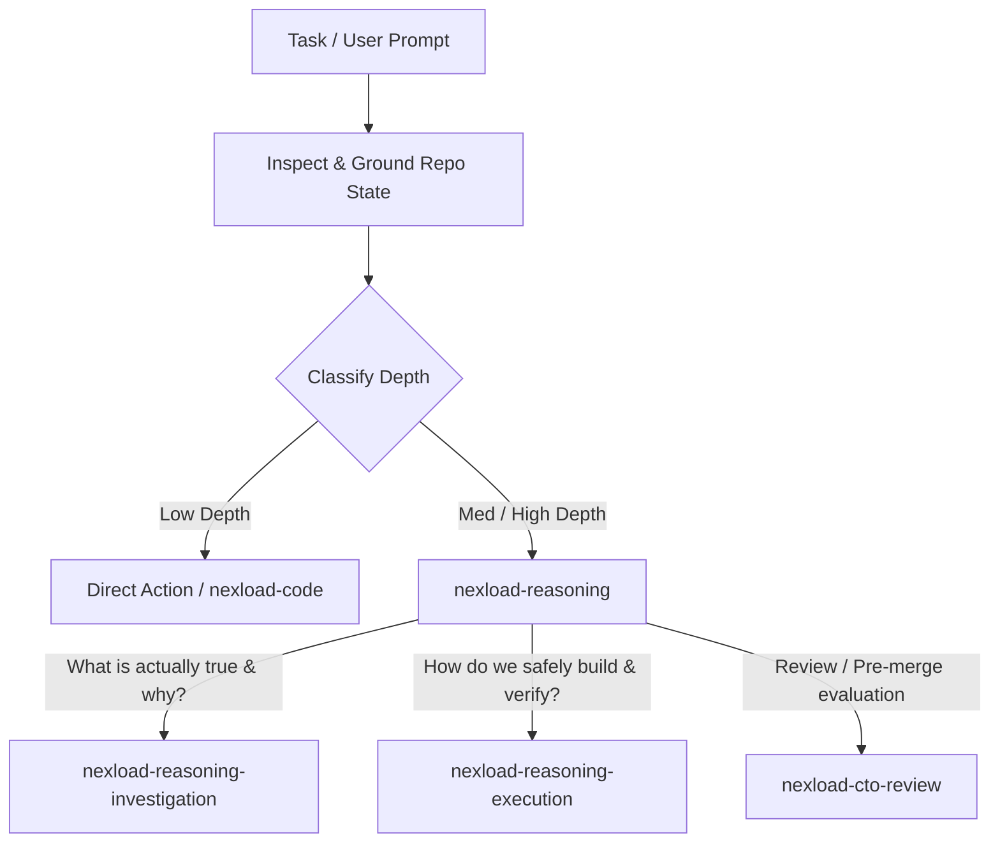

# PersianPart 2.0 — Agent Operating System & Repository Standard

> **Role & Authority**: This document is the governing constitution and operational standard for all autonomous AI agents, coding assistants, and engineers operating on the **PersianPart 2.0** repository. All actions, architectural decisions, and code modifications MUST strictly comply with these rules.

---

## 1. The Inviolable Constitution (Binding Invariants)

Every cognitive pass, decision, and implementation step in this repository executes under eight non-negotiable invariants:

### 1.1 Evidence Hierarchy (Grounding Gate)
$$\text{Runtime Observation} > \text{Code/Config} > \text{Official Docs} > \text{Project Docs} > \text{Inference} > \text{Assumption}$$
- Hard empirical facts always supersede speculative inference or outdated documentation.
- Any claim or decision lacking direct evidence MUST be explicitly tagged with `[ASSUMPTION]` or `[UNKNOWN]`.
- Fabricated success or ungrounded certainty is an automatic disqualification.

### 1.2 Inspect Before Ask (Question Gate)
- If an answer can be found in codebase files, configuration manifests, git history, environment variables, or local CLI tools: **INSPECT FIRST**.
- Never prompt or ask the human for information already present in the workspace, system state, or execution logs.

### 1.3 Problem Space Framing
- Proposed technical solutions (e.g., "Add Redis", "Create a microservice", "Add an abstraction layer") are **implementation hypotheses**, NEVER requirements.
- Always analyze and frame the underlying problem, business constraint, and failure mode before evaluating or committing to a solution mechanism.

### 1.4 Separation of Divergence and Convergence (Divergence Firewall)
- During ideation or architectural exploration, ideas and candidate mechanisms **MUST NOT** be prematurely filtered by implementation difficulty, immediate cost, or local familiarity.
- Divergent generation and convergent evaluation must NEVER run in the same cognitive pass.

### 1.5 Complexity Must Pay Rent
- Any newly introduced dependency, abstraction, layer, or state machine must measurably reduce system complexity or satisfy confirmed, non-negotiable hard requirements.
- **Speculative scalability is rejected.** Design strictly for $\text{Now} + 1$, NEVER for $\text{Now} + 10$. If simple inline code solves the problem, layers of indirection are prohibited.

### 1.6 Preservation of Settled Decisions
- Approved architectural decision records (ADRs), user-approved plans, and explicit architectural boundaries are **IMMUTABLE**.
- Never reopen, re-litigate, or silently diverge from settled decisions without presenting new, material, contradictory empirical evidence.

### 1.7 Claim-Matched Verification
- `"Builds" \neq "Works"`. `"Configured" \neq "Exposed"`. `"Added" \neq "Verified"`.
- Every completion claim requires observable, reproducible empirical evidence matching the exact scope of the claim.

### 1.8 Dynamic Reasoning Budget
- The moment remaining uncertainty has **zero material impact** on the final action, architecture, security, or correctness: **STOP REASONING IMMEDIATELY**.
- Do not engage in ceremonial or bureaucratic over-analysis when the next step is unambiguous.

---

## 2. Workspace & Technology Stack Specification

PersianPart 2.0 is an e-commerce platform architected as a monorepo.

| Dimension | Specification & Rules |
| :--- | :--- |
| **Monorepo Architecture** | Managed strictly via **pnpm workspaces** (`apps/*`, `packages/*`). |
| **Package Manager** | Use **`pnpm`** (v11.18+) for package management. Bun is permitted as the API runtime, not as the package manager. |
| **Frontend Application** | `apps/web` (Client SPA). |
| **Frontend Core** | **React 19** + **TypeScript 7** (Strict mode) + **Vite 8**. |
| **Routing** | **TanStack Router** (`@tanstack/react-router`, `@tanstack/router-plugin/vite`) and file-based routing in `src/routes/` for `apps/web`. React Router and Next.js are not used in `apps/web`; `apps/cms` uses Next.js. |
| **Server State / Cache** | **TanStack Query** (`@tanstack/react-query`). |
| **Styling & Design** | **Tailwind CSS v4** (`@tailwindcss/vite`) + **HeroUI v3** (`@heroui/react`, `@heroui/styles`, `framer-motion`). RTL support enabled. |
| **Backend (API)** | `apps/api` — **Hono + oRPC** on the **Bun** runtime (`bun --watch src/server.ts`), plus `@payloadcms/sdk`, `pg`, JWT/OTP and Kavenegar SMS. |
| **CMS** | `apps/cms` — **Payload CMS v3** on **Next.js** + PostgreSQL, Lexical rich text, import/export plugin. |
| **Contract (SSOT)** | `packages/contract` — oRPC contract (`oc`) + Zod; the only place API shapes are defined. `apps/web` and `apps/api` must consume it, never redeclare shapes. |

---

## 3. Installed Agent Skills Inventory & Trigger Routing

`.agents/skills/` contains **19 skills**. `skills-lock.json` records available third-party source metadata and hashes; a hash does not pin an upstream revision. Some skills contain project-specific adaptations. Project-authored skills (`heroui-v3`, `rtl-persian-ui`) have no upstream lock entry.



### 3.1 Cognitive Reasoning Specialists (Kernel + 2)

| Skill | Primary Cognitive Question & Trigger Boundary | Anti-Trigger (When NOT to use) |
| :--- | :--- | :--- |
| **`nexload-reasoning`** | **Kernel & Depth Controller**: Multi-step, cross-cutting, or ambiguous requests; determines reasoning depth and routes to the specialists that remain. | Deterministic commands, trivial syntax fixes, or when a task already targets a specific specialist. |
| **`nexload-reasoning-investigation`** | *"What is actually true/happening and why?"* Trigger on build failures, intermittent bugs, runtime errors, or contradictory telemetry. | Brainstorming features, greenfield design, or roadmap implementation. |
| **`nexload-reasoning-execution`** | *"How do we safely build and verify this result?"* Trigger when executing an approved plan across sequenced phases with claim-matched verification. | Re-debating settled decisions or brainstorming features. |

### 3.2 Domain Implementation Specialists

| Skill | Scope & Trigger Boundary | Specific Repository Rules |
| :--- | :--- | :--- |
| **`nexload-code`** | Internal TypeScript implementation, refactoring, module cohesion, type narrowing, and kebab-case file naming. | Strict TypeScript; no `any`; derive types from schemas/contracts; keep functions focused and side-effects explicit. |
| **`nexload-react`** | React 19 component and hook architecture, render purity, state ownership, effect boundaries, and named exports. | State has one clear owner; effects synchronize only with external systems; pure render; PascalCase components in kebab-case files. |
| **`nexload-design`** | Visual system, Tailwind CSS v4 tokens, HeroUI v3 component styling, responsive layouts, and RTL alignment. | Use Tailwind CSS v4 variables; preserve HeroUI accessibility contracts; ensure bidirectional/RTL correctness. |
| **`nexload-cto-review`** | Architectural review, production readiness evaluation, overengineering audits, scoring, and pre-merge approval. | **Review-only**. Never generates patches, implementations, or code fixes. Limits findings to $\le 3$ material items. |
| **`rtl-persian-ui`** | Persian RTL layout, spacing, copy, numbers, currency and Jalali dates. | Logical utilities only; use `src/lib/utils/{currency,date}.ts`; ZWNJ and mixed-direction rules. |
| **`heroui-v3`** | `@heroui/react` compound components, semantic variants, tokens and events. | Use the `heroui-react` MCP for component-specific APIs, and follow project tokens and conventions. |
| **`design-taste-frontend`** | Anti-generic visual direction for customer-facing screens. | Subordinate to `nexload-design`; never overrides tokens or RTL rules. |
| **`ui-ux-pro-max`** | UI/UX reference for interface design and review. | Follow the project's design system and RTL rules. |

### 3.3 Stack Skills (Frontend Data, API, Contract, CMS)

| Skill | Package / App It Serves | Boundary |
| :--- | :--- | :--- |
| **`tanstack-router-best-practices`** | `@tanstack/react-router` + `@tanstack/router-plugin` in `apps/web`. | File-based routes in `src/routes/`, loaders, search params, type-safe navigation. |
| **`tanstack-query-best-practices`** | `@tanstack/react-query` in `apps/web`. | Server state only; keys live in `src/lib/query-keys.ts`. |
| **`tailwind-css-v4`** | `tailwindcss` + `@tailwindcss/vite` in `apps/web`. | `@theme` tokens and CSS-first config; no v3 `tailwind.config.js` patterns. |
| **`orpc`** | `@orpc/server`, `@orpc/client` across `apps/api`, `apps/web`. | Procedure definition, middleware, server and client wiring. |
| **`orpc-contract`** | `@orpc/contract` in `packages/contract`. | Contract-first shapes with `oc`; no ad-hoc input schemas elsewhere. |
| **`orpc-openapi`** | `@orpc/openapi` in `packages/contract`. | REST metadata and OpenAPI exposure. |
| **`bun-hono-integration`** | Hono on Bun in `apps/api`. | Routing, middleware, context, runtime specifics. |
| **`payload`** | Payload CMS v3 in `apps/cms`. | Collections, fields, hooks, access control, migrations. |

### 3.4 Intentionally Excluded Skills (Complexity Must Pay Rent)

- **shadcn/ui / Radix skills** — the UI layer is HeroUI v3 + Tailwind v4; no Radix or `components.json` exists.
- **Brand, marketing and image-generation packs** (`brand`, `brandkit`, `banner-design`, `design`, `design-system`, `slides`, `stitch-design-taste`, `imagegen-frontend-*`, `image-to-code`, `gpt-taste`, `high-end-visual-design`, `minimalist-ui`, `industrial-brutalist-ui`, `redesign-existing-projects`, `design-taste-frontend-v1`) — the visual system is already defined.
- **`orpc-migrate`** — the repo is oRPC v2 from day one; there is no tRPC or v1 surface to migrate.
- **`full-output-enforcement`** — an LLM-output harness, not repository knowledge.
- **`nexload-package`** — PersianPart is an application monorepo, not a public npm publisher.
- **`graphify`** — omitted to prevent tool bloat on an established codebase.

---

## 4. Sparse Pointer Handoff Protocol (`[NEXLOAD HANDOFF]`)

When transitioning between reasoning specialists or across multi-agent boundaries, agents MUST generate a bounded, low-overhead handoff block instead of dumping massive global context:

```text
[NEXLOAD HANDOFF]
From: <Origin Specialist or Kernel>
To: <Target Specialist>
Context Pointer: <File path, Commit hash, or Issue/ADR reference>
Established Facts:
- <Confirmed empirical observation or verified invariant>
Hard Constraints:
- <Non-negotiable requirement or preserved boundary>
Settled Decisions:
- <Approved architectural choice - IMMUTABLE>
Next Cognitive Objective:
- <Exact cognitive question the target specialist must resolve>
[END HANDOFF]
```

---

## 5. Repository Execution & Verification Runbook

All terminal commands MUST be executed using `pnpm` from the repository root or targeting specific workspaces.

### 5.1 Installation & Dependencies
```bash
# Install all dependencies across the monorepo
pnpm install

# Add production dependency to web app
pnpm --filter @persianpart/web add <package>

# Add dev dependency to web app
pnpm --filter @persianpart/web add -D <package>
```

### 5.2 Verification & Build Pipeline
Verification MUST follow the narrowest-decisive-check-outward rule:

```bash
# 1. TypeCheck (Narrow check without emit)
pnpm --filter @persianpart/web exec tsc --noEmit

# 2. TypeCheck & Production Build
pnpm --filter @persianpart/web build

# 3. Development Server Smoke Test
pnpm --filter @persianpart/web dev --port 5173

# 4. Linting & Formatting (To be configured: recommended Biome or ESLint v9)
# Current: Enforced via TypeScript compiler strictness flags in tsconfig.json

# 5. Tests (existing, not aspirational)
pnpm --filter @persianpart/cms test:hardening          # node:test via tsx (unit)
pnpm --filter @persianpart/cms test:hardening:postgres # requires live Postgres
pnpm --filter @persianpart/api test                    # bun test (warehouse unit suites; live suites are opt-in)
# apps/web: no test runner configured — verify through typecheck and build
```

### 5.3 Route Tree Generation
- TanStack Router route tree (`apps/web/src/routeTree.gen.ts`) is generated automatically by `@tanstack/router-plugin/vite` upon running `vite` or `vite build`.
- Never manually edit `src/routeTree.gen.ts`.
- All routes must be authored in `apps/web/src/routes/` following the file-based routing standard.

---

## 6. Persian & Localization (RTL) Guidelines

- All customer-facing UI in `apps/web` must support **Right-to-Left (RTL)** text direction by default (`<html lang="fa" dir="rtl">`).
- Use logical Tailwind CSS utilities (e.g., `ms-`, `me-`, `ps-`, `pe-`, `start-`, `end-`) rather than fixed directional utilities (`ml-`, `mr-`, `left-`, `right-`) to ensure seamless bidirectional rendering.
- Numbers, monetary amounts, and product codes must be handled with explicit localization formatting (`src/lib/utils/currency.ts`, `src/lib/utils/date.ts`), following the existing helpers.
- Load the **`rtl-persian-ui`** skill before writing or reviewing any Persian-facing screen; it carries the full rule set (ZWNJ, mixed-direction text, Jalali dates, safe areas).
