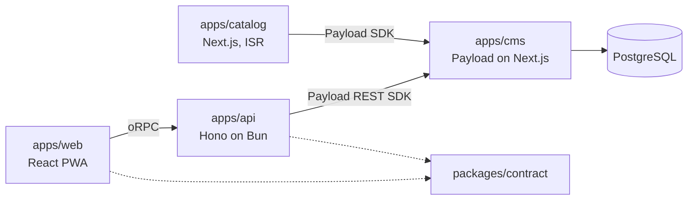

# PersianPart 2.0

[](https://github.com/gecut/persianpartshop.ir/actions/workflows/pipeline.yml)

**B2B ordering platform for tiles, ceramics and slabs: live stock, tier pricing and stock reservation for sales representatives, plus a public product catalog.**

## Overview

PersianPart distributes tiles and ceramics from several factories to shop owners and small retailers. These retailers are its sales representatives. This system is a **mediation layer**, not an ERP: accounting stays in Kimia, real warehouse management in the company's own systems, and shipping happens offline. The system holds only sellable stock, prices and order records.

| Application | Audience | Purpose |
| --- | --- | --- |
| `apps/web` | Sales representatives | Installable Persian RTL PWA: browse stock and prices 24/7, reserve stock by placing an order, file supply requests |
| `apps/catalog` | Designers, architects, contractors, end consumers | Public catalog with retail prices, no login or ordering |
| `apps/cms` | Staff | Admin panel: products, customers, orders, warehouses, stock and price import |

### Key capabilities

- Tile quantities converted to whole cartons; non-tile goods in their own units.
- Customer-tier pricing from one shared price list.
- One warehouse per cart; transactional, idempotent reservation; 60-minute customer cancellation window.
- Two warehouse modes: `exact` (numeric balance) and `inquiry` (staff ask the factory), with a manual supply-request flow.
- Daily stock and price import from the Kimia accounting export, with signed preview and atomic apply.
- SMS OTP login and order notifications (Kavenegar).
- Optional AI-agent access to the CMS over MCP.

## Architecture



The CMS owns data, stock and the order lifecycle. The API implements the shared oRPC contract and talks to the CMS. Details: [system architecture](docs/architecture/system-architecture.md).

## Tech stack

| Layer | Technology |
| --- | --- |
| Monorepo | pnpm workspaces |
| Web | React 19, TypeScript, Vite, TanStack Router and Query, HeroUI v3, Tailwind CSS v4 |
| API | Hono + oRPC on Bun, Zod |
| CMS | Payload CMS v3 on Next.js, Lexical |
| Catalog | Next.js App Router, ISR |
| Database | PostgreSQL |
| Deployment | Docker Compose (Dokploy), GitHub Actions, GHCR images |

## Repository layout

```text
apps/
  web/        Customer PWA (port 5173)
  cms/        Admin panel and data owner (port 5174)
  api/        Customer-facing API (port 5175)
  catalog/    Public catalog (port 5176)
packages/
  contract/   Shared oRPC + Zod contract (single source of API shapes)
docs/         Product, architecture, operations and standards docs
```

## Getting started

### Prerequisites

- Node.js 22+ and [pnpm](https://pnpm.io) 11.18 (`packageManager` is pinned in `package.json`)
- [Bun](https://bun.sh) 1.4.4 (API runtime and dependency check)
- PostgreSQL

### Setup

```bash
pnpm install
```

Copy each app's example environment file and fill in the values (`DATABASE_URL`, `PAYLOAD_SECRET`, `JWT_SECRET`, `CMS_API_KEY`, Kavenegar keys, …). Never commit real secrets.

```bash
cp apps/cms/.env.example apps/cms/.env
cp apps/api/.env.example apps/api/.env
cp apps/catalog/.env.example apps/catalog/.env
```

Create the schema, then optionally load local demo data. Seeding runs only against a guarded local database; see the [runbook](docs/operations/runbook.md#migration-seed-and-deployment).

```bash
pnpm migrate:cms
pnpm seed:cms
```

### Run

```bash
pnpm dev:cms       # http://localhost:5174
pnpm dev:api       # http://localhost:5175
pnpm --filter @persianpart/web dev       # http://localhost:5173
pnpm dev:catalog   # http://localhost:5176
```

Set `DISABLE_SMS=true` to avoid sending real SMS during development.

## Scripts

| Command | What it does |
| --- | --- |
| `pnpm check-types` | Type-check every workspace |
| `pnpm test:unit` | Isolated unit tests across workspaces |
| `pnpm check:deps` | Architecture guard: import cycles, layers, private files (needs Bun) |
| `pnpm build` | Build CMS, API (type-check), web and catalog |
| `pnpm migrate:cms`, `pnpm migrate:cms:status` | Run or inspect CMS migrations |

CI (`.github/workflows/pipeline.yml`) runs install, type-check, unit tests and build on every push and pull request to `main`, then builds and deploys container images from `main`.

## Deployment

`docker-compose.yml` defines the `migration`, `cms`, `api`, `catalog`, `web` and `cdn` services (media is served by the CDN image). Startup order is migration → CMS → API and catalog. PostgreSQL is not part of the compose file; provide `DATABASE_URL`. No host ports are exposed; public routing is done by Dokploy. Required variables are listed in [`.env.example`](.env.example). Production state is not recorded in this repository: a setting existing in code does not mean it is deployed.

## Documentation

Start at the [documentation index](docs/README.md). Quick links:

- [Product overview](docs/product/overview.md): who uses this system and what is out of scope
- [Business rules](docs/product/business-rules.md): pricing, rounding, stock, cancellation and import, each with its reason and a worked example
- [System architecture](docs/architecture/system-architecture.md)
- [Runbook](docs/operations/runbook.md): operations, CSV import, migrations, MCP access

## Working with AI agents

This repository is maintained with LLM coding agents. [`AGENTS.md`](AGENTS.md) is the operating standard (evidence rules, stack constraints, verification commands, commit policy); `CLAUDE.md` is its Claude Code entry point. Agent skills live in `.agents/skills/`.

## Contributing

1. Read `AGENTS.md` and the relevant docs before changing behavior.
2. Run `pnpm check-types`, `pnpm test:unit` and `pnpm check:deps` before committing.
3. Use Conventional Commits (`feat(scope): summary`).
4. Update the owning document in `docs/` in the same commit when behavior changes.

## License

Proprietary. Copyright (c) 2026 Gecut (gecut.ir); all rights reserved. This repository is private to Gecut and its business, PersianPart. See [LICENSE](LICENSE).
