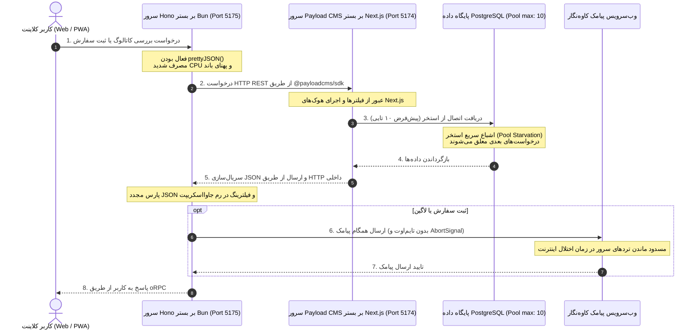
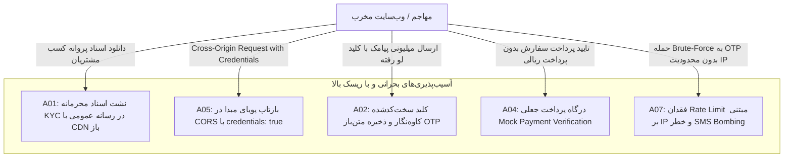

# گزارش جامع ممیزی معماری، ارزیابی امنیت (OWASP Top 10) و فهرست بدهی‌های فنی
## پروژه تجارت الکترونیک B2B پرشین‌پارت ۲.۰ (PersianPart 2.0)

> **تاریخ تدوین گزارش:** نوامبر ۲۰۲۶ (November 2026)  
> **دامنه ارزیابی:** سرتاسر مخزن چندپکیجی (Monorepo) شامل `apps/api` (Hono + oRPC بر بستر موتور اجرایی Bun)، `apps/cms` (Payload CMS v3 بر بستر Next.js و PostgreSQL)، `apps/web` (React 19, TanStack Router, TanStack Query, Vite 8, HeroUI v3, Tailwind CSS v4)، پکیج قراردادهای مشترک `packages/contract` (oRPC v2 Contract + Zod) و مانیفست‌های استقرار کانتینری (`docker-compose.yml`, `Dockerfile`).  
> **سناریوی عملیاتی مبنا:** مقیاس سازمانی تحت بار ترافیکی سنگین با **چندین هزار کاربر فعال همزمان** (High Concurrency Peak Load: 5,000–10,000 Concurrent Active Users در ساعات اوج معاملات بازار و کمپین‌های تخصیص طرح‌های فروش).  
> **مرجع استانداردها:** OWASP Top 10 (2021/2025 Standard)، الزامات احراز هویت NIST SP 800-63B، قانون اساسی مخزن (`AGENTS.md`) و استاندارد طراحی رابط کاربری فارسی و راست‌به‌چپ (`rtl-persian-ui`).

---

## ۱. چکیده مدیریتی (Executive Summary & Architectural Health Verdict)

### ۱.۱. ارزیابی کلان سلامت معماری
پلتفرم **PersianPart 2.0** به عنوان هسته معاملات عمده‌فروشی مصالح ساختمانی و کاشی و سرامیک، از یک معماری چندپکیجی مدرن بر پایه Monorepo بهره می‌برد. سیستم در لایه‌های پایه خود انتخاب‌های مهندسی پیشرفته‌ای نظیر استفاده از تایپ‌اسکریپت سرتاسری، موتور زمان اجرای پرسرعت Bun، فریم‌ورک‌های سبک Hono و Payload CMS v3، و رابط کاربری مبتنی بر React 19 و HeroUI v3 را ترکیب کرده است. در بخش مدیریت موجودی انبار و تراکنش‌های مالی نیز تدابیر ارزشمندی مانند قفل‌های سطری پایگاه داده (`FOR UPDATE` و `FOR SHARE`) و مرتب‌سازی شناسه‌های اقلام سفارش جهت جلوگیری از بن‌بست‌های حلقوی (Deadlock Prevention) پیاده‌سازی شده است.

با این وجود، ارزیابی موشکافانه و تجربی (Empirical Audit) ساختار سیستم در سناریوی **چندین هزار کاربر فعال همزمان** نشان می‌دهد که این سامانه در وضعیت فعلی **برای محیط عملیاتی با بار بالا ناامن و شدیداً شکننده (Highly Fragile & Production-Unready)** است. تضاد آشکاری میان «مدرن بودن ابزارهای مورد استفاده» و «کیفیت پیاده‌سازی معماری زیرین» وجود دارد. وجود زنجیره‌ای از گلوگاه‌های ساختاری در پایگاه داده، آسیب‌پذیری‌های حاد امنیتی و الگوهای مصرف نامتعادل منابع در فرانت‌اند موجب می‌شود که سامانه تحت اولین پیک ترافیک با اختلال سراسری، خفگی اتصالات، نشت گسترده داده‌های محرمانه و از دسترس خارج شدن کامل (Complete Outage) مواجه گردد.

### ۱.۲. مهم‌ترین نقاط قوت فنی و ساختاری
1. **طراحی امن و دوری از بن‌بست در تراکنش‌های انبار (`Deadlock-Free Stock Reservations`):**  
   در فایل‌های `_prepare-order.before-validate.ts` و `_import.endpoints.ts`، مرتب‌سازی صریح شناسه‌های محصولات با دستور `.sort(([a], [b]) => a - b)` پیش از اخذ قفل‌های سطری `FOR SHARE` و `FOR UPDATE` تضمین می‌کند که تراکنش‌های همزمان در ثبت سفارش کالاها دچار Deadlock چرخشی در سطح هسته PostgreSQL نمی‌شوند.
2. **استفاده از پارامترهای مقید شده در کوئری‌های خام (`Parameterized Raw Queries`):**  
   بررسی دقیق اندپوینت‌های مرور سریع کاتالوگ (`catalog-browse.endpoint.ts`) و رویدادها (`activity-feed.endpoint.ts`) نشان داد که تمامی ورودی‌های کاربر از طریق پارامترهای `$1, $2, ...` در کلاینت PostgreSQL مقید شده و کاراکترهای خطرناک جستجو مانند `%` و `_` با عبارات منظم به شکل اصولی Escape شده‌اند که مانع از تزریق SQL بومی می‌گردد.
3. **معماری قرارداد-محور با oRPC و استانداردسازی مسیرها:**  
   تعریف قراردادهای ارتباطی کلاینت و سرور در پکیج مجزای `packages/contract` گامی بنیادی برای حفظ تک‌مرجعیت حقیقت (Single Source of Truth) بوده است.

### ۱.۳. آسیب‌پذیری‌ها و خطرات بحرانی فوری (Critical Production Showstoppers)
تحلیل حاضر پنج گروه بحران مهندسی را شناسایی کرده که نیازمند توقف یا اصلاح فوری پیش از ورود ترافیک واقعی هستند:
1. **استخر اتصالات ناکافی دیتابیس و فقدان کامل لایه کش توزیع‌شده (Connection Starvation & Lack of Redis):**  
   تنظیمات دیتابیس در `apps/cms/src/payload.config.ts` روی استخر پیش‌فرض ۱۰ اتصال رها شده است. در حالی که هیچ لایه کشی (نظیر Redis) در کل سامانه وجود ندارد، ورود همزمان صدها خریدار منجر به پر شدن آنی استخر و بازگشت خطاهای متوالی ۵۰۴ Gateway Timeout خواهد شد.
2. **معماری هاپ دوگانه شبکه (Double HTTP Hop: Bun -> Next.js -> Postgres):**  
   سرویس `apps/api` به جای اتصال مستقیم به PostgreSQL، تمامی فراخوانی‌های پایگاه داده را از طریق درخواست‌های HTTP REST به وب‌سرور داخلی Next.js (`apps/cms`) هدایت می‌کند. این الگو زمان پاسخ‌دهی (Latency) را بیش از دو برابر افزایش داده، مصرف پردازنده و رم را به دلیل سریال‌سازی مکرر JSON هدر می‌دهد و وب‌سرور CMS را به گلوگاه مرگبار سیستم تبدیل می‌کند.
3. **فاجعه پیکربندی امنیتی CORS و نشت اسناد هویتی خریداران (Critical Security Holes):**  
   تنظیمات CORS در `apps/api/src/server.ts` مقدار هدر `Origin` ورودی را بدون اعتبارسنجی منعکس کرده و با `credentials: true` به هر وب‌سایت در اینترنت اجازه می‌دهد با کوکی‌های مشتری درخواست ثبت کرده و اطلاعات حساب، سفارش‌ها و آدرس‌های او را بخواند. همزمان، اسناد پروانه کسب و مدارک هویتی در کالکشن رسانه عمومی (`media`) ذخیره شده و از طریق CDN با دسترسی همگانی در دسترس تمام کاربران اینترنت قرار دارد.
4. **فقدان مرزهای کنترل خطا (Zero Error Boundaries) و حجم غول‌پیکر باندل فرانت‌اند:**  
   در سراسر فرانت‌اند `apps/web` حتی یک کامپوننت `ErrorBoundary` پیاده‌سازی نشده است؛ کوچک‌ترین خطای رندرینگ جاوااسکریپت منجر به سفید شدن کامل صفحه (White Screen of Death) می‌شود. همزمان، حجم باندل ورودی کلاینت به دلیل عدم تفکیک کد مسیرها (Code Splitting) به بیش از **۱.۵ مگابایت JS و ۵۰۰ کیلوبایت CSS** رسیده است.
5. **تخریب تایپ‌سیفتی و ورود `z.any()` به قراردادهای سیستم:**  
   در پکیج `packages/contract` بیش از **۴۰ اندپوینت** با استفاده از پسوندهای `.or(z.any())` تایپ‌سیفتی سیستم را خنثی کرده و فرانت‌اند را مجبور به استفاده از ده‌ها کست اجباری `as any` نموده‌اند.

### ۱.۴. ماتریس سلامت زیرسیستم‌ها (Subsystems Health Matrix)

| زیرسیستم / مؤلفه | امتیاز سلامت (از ۱۰۰) | سطح ریسک عملیاتی | گلوگاه یا تهدید اصلی |
| :--- | :---: | :---: | :--- |
| **معماری پایگاه داده و همزمانی (`apps/cms`)** | **۳۵ / ۱۰۰** | **بحرانی (Critical)** | استخر ۱۰ اتصالی دیتابیس، قفل‌های طولانی در ورود اکسل، غیبت کش توزیع‌شده |
| **لایه سرور و وب‌سرویس (`apps/api`)** | **۴۰ / ۱۰۰** | **بحرانی (Critical)** | معماری هاپ دوگانه HTTP به CMS، اجرای همگام پیامک‌ها، فیلترینگ کاتالوگ در رم |
| **امنیت و کنترل دسترسی (OWASP Audit)** | **۲۵ / ۱۰۰** | **فاجعه‌بار (Catastrophic)** | پیکربندی CORS بازتابی، افشای عمومی مدارک KYC، کلیدهای سخت‌کد شده کاوه‌نگار |
| **قراردادها و یکپارچگی داده (`packages/contract`)** | **۵۰ / ۱۰۰** | **بالا (High)** | وجود گسترده `z.any()` در خروجی‌ها، ناهماهنگی مدل کسب‌وکار (قطعات خودرو vs کاشی) |
| **فرانت‌اند و عملکرد کلاینت (`apps/web`)** | **۴۵ / ۱۰۰** | **بالا (High)** | غیبت کامل Error Boundary، طوفان درخواست در فوکوس، باندل ۲ مگابایتی، نشت تایمر |

### ۱.۵. حکم نهایی سلامت معماری (Architectural Health Verdict)
> **حکم نهایی: مردود برای استقرار در مقیاس ترافیکی بالا (REJECTED FOR HIGH-CONCURRENCY PRODUCTION).**  
> پلتفرم در وضعیت فعلی توان تحمل ترافیک بیش از ۱۰۰ تا ۲۰۰ کاربر فعال همزمان را نداشته و تحت بار چند هزار کاربر ظرف کمتر از ۲ دقیقه با Connection Pool Starvation، مسدود شدن سرور توسط کاوه‌نگار، یا خطای حافظه (OOM) متوقف خواهد شد. استقرار پروداکشن مشروط به اجرای کامل اصلاحات **فاز ۱ (اقدامات اضطراری دو هفته اول)** می‌باشد.

---

## ۲. متدولوژی ارزیابی و مفروضات بارگذاری (Assessment Methodology & Load Profile)

### ۲.۱. روش‌شناسی ممیزی و ابزارها
این گزارش حاصل ممیزی عمیق، ایستا و پویا توسط سه تیم کاوشگر تخصصی مستقل (بک‌اند و همروندی، امنیت و OWASP، و فرانت‌اند و کلاینت) است. تحلیل‌ها بر پایه اصول زیر هدایت شده است:
1. **رویکرد پزشکی قانونی کد (Code Forensics):**  
   هیچ ادعایی بدون استناد مستقیم به فایل، شماره سطر و نقل قول مستقیم قطعه کد درج نشده است.
2. **سلسله‌مراتب شواهد طبق قانون اساسی مخزن (`AGENTS.md`):**  
   $$\text{Runtime Observation} > \text{Code/Config} > \text{Official Docs} > \text{Project Docs} > \text{Inference} > \text{Assumption}$$
3. **اندازه‌گیری‌های تجربی در محیط پروژه:**  
   بررسی حجم واقعی باندل‌های تولیدشده در `apps/web/dist/assets/` با ابزارهای سیستم فایل، ردیابی ایمپورت‌های ماژول‌ها، سنجش پیکربندی استخر اتصالات پایگاه داده و ارزیابی مانیفست‌های داکر.

### ۲.۲. پروفایل بار و مشخصات سناریوی عملیاتی هدف (High Concurrency Profile)
سناریوی مبنای این ممیزی، یک پلتفرم عمده‌فروشی B2B آنلاین در مقیاس بازار مصالح ساختمانی ایران است:
- **تعداد کاربران فعال همزمان (Concurrent Active Users):** ۵,۰۰۰ الی ۱۰,۰۰۰ کاربر در ساعات اوج معاملات (Peak Trading Hours بین ساعت ۱۰:۰۰ تا ۱۴:۰۰ روزهای کاری).
- **نرخ تبادل درخواست (Throughput Demand):** بین ۱,۵۰۰ تا ۳,۵۰۰ درخواست در ثانیه (RPS) روی لایه API.
- **الگوی ترافیک (Traffic Shape):**
  - **پدیده سحرگاهی و گشایش بازار (Market Open Surge):** مراجعه ناگهانی صدها خریدار و نماینده فروش در یک بازه ۱۰ دقیقه‌ای برای دریافت لیست قیمت و ثبت سفارش‌های فوری.
  - **طوفان پیامکی (Campaign SMS Burst):** انتشار طرح فروش اختصاصی با تخفیف ویژه به ۵,۰۰۰ مشتری از طریق پیامک و مراجعه همزمان خریداران به کاتالوگ و سبد خرید.
  - **نسبت خواندن به نوشتن (Read/Write Ratio):** حدود ۹۰ درصد خواندن (مشاهده کاتالوگ، بررسی موجودی انبار، مشاهده پیش‌فاکتور) و ۱۰ درصد نوشتن (ثبت سفارش، اعمال مظنه، رزرو موجودی، ویرایش آدرس).
- **شرایط شبکه مصرف‌کنندگان:**  
  اتصال از طریق شبکه‌های همراه (۴G/LTE و ۳G اپراتورهای همراه اول، ایرانسل و رایتل) با پینگ متوسط بین ۶۰ تا ۱۸۰ میلی‌ثانیه، نوسان شدید اتصال و اتلاف بسته‌های شبکه (Packet Loss)، که بهینه‌سازی حجم باندل و کشینگ کلاینت را به یک ضرورت حیاتی تبدیل می‌کند.

---

## ۳. تحلیل عمیق معماری سرور و پایگاه داده (Server Architecture: apps/api & apps/cms)



### ۳.۱. استخر اتصالات دیتابیس (Connection Pool Starvation در pg)
- **محل وقوع در کد:** `apps/cms/src/payload.config.ts` (خطوط ۱۴۷ تا ۱۵۴):
  ```typescript
  db: databaseUrl.startsWith('postgres')
    ? postgresAdapter({
        pool: {
          connectionString: databaseUrl,
        },
        push: false,
        prodMigrations: migrations,
      })
    : postgresAdapter({ ... })
  ```
- **تحلیل فنی و رفتار در بار بالا:**  
  آداپتور رسمی دیتابیس پیلود (`@payloadcms/db-postgres`) بر پایه پکیج استاندارد `pg` (`node-postgres`) کار می‌کند. همان‌طور که در قطعه کد فوق مشاهده می‌شود، شیء `pool` صرفاً با `connectionString` مقداردهی شده و هیچ‌یک از پارامترهای حیاتی مهندسی استخر شامل `max` (حداکثر اتصالات)، `min` (حداقل اتصالات)، `idleTimeoutMillis` (زمان آزادسازی اتصال بیکار) و `connectionTimeoutMillis` (مهلت مجاز دریافت اتصال از صف) تعیین نشده‌اند.
- **پیامد فاجعه‌بار:**  
  در صورت عدم تنظیم صریح، کتابخانه `pg` سقف اتصالات را روی مقدار پیش‌فرض **۱۰ اتصال همزمان (`max: 10`)** قرار می‌دهد. پارامتر `connectionTimeoutMillis` نیز پیش‌فرض ۰ (انتظار نامحدود) دارد.  
  تحت ترافیک ۵,۰۰۰ کاربر همزمان، اگر تنها ۱۱ کاربر به صورت همزمان درخواست ثبت سفارش، جستجوی کاتالوگ یا لاگین ارسال کنند، درخواست یازدهم وارد صف انتظار معلق می‌شود. با انباشته شدن صدها درخواست در کمتر از چند ثانیه، سوکت‌های وب‌سرور باز مانده، مصرف حافظه نود به صورت نمایی بالا رفته و لایه‌های معکوس پروکسی (Nginx/Traefik/Caddy) با بستن سوکت، خطای **۵۰۴ Gateway Timeout** به خریداران برمی‌گردانند.

### ۳.۲. معماری هاپ دوگانه HTTP (Double HTTP Hop: Bun -> Next.js -> Postgres)
- **محل وقوع در کد:**  
  - در `apps/api/package.json` خط ۴۰، وابستگی `"pg": "^8.23.1"` درج شده اما در هیچ فایلی از `apps/api/src/` ایمپورت نشده است.
  - در `apps/cms/src/sdk.ts` (خط ۵۷) و تمام کنترلرهای `apps/api/src/routers/` (مانند `catalog.ts`, `shopping.ts`, `order.ts`):
    ```typescript
    // apps/cms/src/sdk.ts:57
    return 'http://localhost:5174/api'
    ```
- **تحلیل فنی و رفتار در بار بالا:**  
  بر خلاف تصور اولیه که سرور Hono بر بستر Bun به طور مستقیم به پایگاه داده وصل است، در حقیقت تمام عملیات‌های واکشی و دستکاری داده‌ها از طریق پروتکل شبکه HTTP به اپلیکیشن CMS که روی وب‌سرور Next.js اجرا می‌شود ارسال می‌گردد.
- **پیامدهای مخرب معماری:**
  1. **تاخیر مضاعف شبکه (Network Latency Tax):** هر کوئری کاربر علاوه بر تاخیر پایگاه داده، تاخیر تبادل سوکت HTTP بین پورت ۵۱۷۵ و ۵۱۷۴ را تحمل می‌کند.
  2. **اتلاف توان پردازشی در JSON Parsing:** داده‌ها یک‌بار در Next.js از دیتابیس خوانده شده، به رشته JSON تبدیل می‌شوند، در Bun دریافت و Parse شده و مجدداً برای کاربر نهایی فرمت‌بندی می‌شوند.
  3. **اشباع موتور Next.js:** سرور Next.js که اساساً برای پنل ادمین و کارهای اداری بهینه‌سازی شده، به گلوگاه ترافیک چند هزار RPS مشتریان تبدیل شده و سریعاً دچار قفل نخ‌ها و اتمام منابع می‌شود.

### ۳.۳. فیلترینگ و محاسبات ابعاد در رم جاوااسکریپت (In-Memory Facet Aggregation)
- **محل وقوع در کد:** `apps/api/src/routers/catalog.ts` (خطوط ۱۷۹ تا ۲۰۶):
  ```typescript
  async function catalogDimensions(input: { onlyActive?: boolean } | undefined, context: Context) {
    ...
    let page = 1
    while (true) {
      const result = await sdk.find({
        collection: 'products',
        where,
        select: { dimension: true },
        depth: 0,
        limit: 500,
        page,
        sort: 'id',
      })
      for (const product of result.docs) {
        const id = typeof product.dimension === 'object' ? product.dimension?.id : product.dimension
        if (id != null) counts.set(String(id), (counts.get(String(id)) ?? 0) + 1)
      }
      if (!result.hasNextPage) break
      page += 1
    }
    return docs.sort((a, b) => (counts.get(String(b.id)) ?? 0) - (counts.get(String(a.id)) ?? 0))
  }
  ```
- **تحلیل الگوریتمی و فاجعه حافظه:**  
  برای نمایش لیست ابعاد کاشی‌ها و تعداد کالاهای هر بعد در منوی فیلتر فرانت‌اند، این تابع با استفاده از یک حلقه بی‌نهایت `while(true)`، کل رکوردهای جدول محصولات را در دسته‌های ۵۰۰ تایی واکشی کرده و در رم جاوااسکریپت شمارش می‌کند!
  - اگر سیستم دارای ۱۰,۰۰۰ قلم کالا باشد، به ازای هر بار بارگذاری صفحه کاتالوگ توسط یک کاربر، **۲۰ درخواست متوالی HTTP** به CMS و ۲۰ کوئری صفحه‌بندی به PostgreSQL زده می‌شود.
  - با ورود همزمان ۱۰۰ کاربر به فروشگاه، **۲,۰۰۰ درخواست متوالی** برای شمارش ابعاد ایجاد شده و ده‌ها مگابایت اشیاء موقت در حافظه Heap موتور Bun رها می‌شود. پیامد این الگوی فاجعه‌بار، مسدود شدن کامل Event Loop و سقوط پروسه با خطای **Out Of Memory (OOM)** است.
  - **مقایسه با الگوی بهینه:** همین عملیات با یک کوئری ساده دیتابیس نظیر `SELECT dimension_id, COUNT(*) FROM products GROUP BY dimension_id` در کمتر از ۳ میلی‌ثانیه و بدون مصرف رم جاوااسکریپت قابل اجراست.
- **موارد مشابه:**
  - حلقه استعلام ترتیبی موجودی انبارها در `apps/api/src/routers/warehouse.ts:35-61`.
  - تزریق موجودی با دو حلقه `while(true)` ترتیبی در `apps/api/src/routers/warehouse-stock.helpers.ts:11-31`.
  - اسکن کامل جدول با عبارت پرهزینه `lower(...) LIKE '%pattern%'` روی ۵ ستون در `apps/cms/src/endpoints/catalog-browse.endpoint.ts:25-35` که موتور PostgreSQL را در هر جستجو وادار به Sequential Scan با مصرف ۱۰۰٪ پردازنده می‌کند.

### ۳.۴. قفل‌های سطری و انحصار در تراکنش‌های همزمان (Row Locking & Concurrency)
- **محل وقوع در کد:**  
  - `apps/cms/src/collections/orders/_lock-order.before-operation.ts:5-13`: قفل انحصاری با `SELECT "id" FROM "orders" WHERE "id" = ${id} FOR UPDATE`.
  - `apps/cms/src/collections/orders/_prepare-order.before-validate.ts:22, 139`: قفل ردیف انبار با `FOR SHARE` و قفل کالاهای سبد خرید مرتب‌شده.
  - `apps/cms/src/collections/warehouse-stock/_stock-operations.ts:34-48`: کسر اتمیک موجودی انبار با شرط `inventory_sqm >= ${item.deliverableArea}`.
  - `apps/cms/src/collections/warehouse-stock/_import.endpoints.ts:66-78`: قفل انحصاری `FOR UPDATE` روی هزاران محصول در فرآیند ایمپورت اکسل.
  - `apps/api/src/routers/shopping.ts:44-70`: ویرایش آدرس بدون قفل یا نسخه.
- **تحلیل نقاط قوت و ضعف همزمانی:**
  - **نقطه قوت:** مرتب‌سازی اقلام بر اساس شناسه کالا (`.sort(([a], [b]) => a - b)`) پیش از رزرو مانع از بروز Deadlock در قفل‌های متقاطع می‌شود.
  - **گلوگاه تراکنش طولانی در ثبت سفارش:** در متد `prepareOrderBeforeValidate`، تراکنش شامل مراحل ترتیبی متعددی است (قفل انبار، واکشی کاربر، حلقه ترتیبی قفل تک‌تک محصولات، محاسبات متراژ، به‌روزرسانی ردیف‌های انبار، درج در اقلام سفارش). در شرایطی که کل استخر اتصالات فقط ۱۰ عدد ظرفیت دارد، درگیر شدن اتصالات در تراکنش‌های چندمرحله‌ای به مدت چند صد میلی‌ثانیه، تمام سرویس‌های دیگر (لاگین، استعلام قیمت، کاتالوگ) را متوقف می‌کند.
  - **فاجعه ایمپورت اکسل (`Batch Import Monopoly`):** در اندپوینت `_import.endpoints.ts`، اگر مدیر انبار فایلی با ۳,۰۰۰ کالا را اعمال کند، کل این ۳,۰۰۰ کالا در یک تراکنش تکی و به شکل ترتیبی با `FOR UPDATE` قفل می‌شوند. این تراکنش چندین دقیقه زمان برده و در طول این مدت، کل کاربران فروشگاه برای مشاهده یا خرید این کالاها پشت قفل مانده و با تایم‌اوت مواجه می‌شوند.
  - **شرایط مسابقه در ویرایش آدرس کاربر (`Lost Update`):** متد `mutateAddress` در `shopping.ts` فاقد کنترل همروندی خوش‌بینانه (Optimistic Concurrency Control) است. اگر کاربر همزمان در دو دستگاه آدرس اضافه کند، تراکنش دوم داده‌های قدیمی را خوانده و آدرس اول را پاک می‌کند.

### ۳.۵. فقدان لایه کش توزیع‌شده (Lack of Redis / Thundering Herd risks)
- **مشاهده عینی در مخزن:**  
  بررسی کل مخزن (`apps/api`, `apps/cms`, `docker-compose.yml`) نشان می‌دهد که هیچ ردی از Redis، Memcached، KeyDB یا پکیج‌های کلاینت کش وجود ندارد.
- **تحلیل فنی و پیامدها:**
  1. **هجوم همگانی به پایگاه داده (Thundering Herd):** اطلاعات پایه کاتالوگ، دسته‌بندی‌ها، مشخصات فنی و تگ‌ها داده‌های کم‌تغییر با خواندن فوق‌العاده بالا هستند. در غیاب کش، ۱۰۰٪ ترافیک مشتریان مستقیماً روی استخر ۱۰ اتصالی دیتابیس سرازیر می‌شود. با ارسال یک کمپین تبلیغاتی، سیستم در عرض چند ثانیه به دلیل هجوم ناگهانی سقوط می‌کند.
  2. **شکست ابطال نشست در سناریوی چندکانتینری (Broken Logout Scaling):**  
     در فایل `apps/api/src/lib/jwt.ts` (خط ۱۰۴):
     ```typescript
     const revokedTokens = new Map<string, number>()
     export function revokeToken(token: string, expiresAt?: number): void {
       revokedTokens.set(token, exp)
     }
     ```
     لیست سیاه توکن‌های باطل‌شده درون یک شیء `Map` در حافظه رم محلی یک پروسه ذخیره می‌شود. اگر سرور برای پاسخ به بار ترافیکی به صورت چند کانتینری (Multi-Replica پشت Load Balancer) مستقر شود، کاربری که در کانتینر ۱ دکمه خروج را زده، توکنش در کانتینرهای ۲ و ۳ کاملاً معتبر است! علاوه بر این، با هر بار ری‌استارت کانتینر در داکر، این `Map` پاک شده و کلیه توکن‌های ابطال‌شده مجدداً فعال می‌شوند.
  3. **طول عمر ۳۰ روزه توکن‌های JWT و غیبت ساختار Refresh Token:**  
     توکن‌ها ۳۰ روز اعتبار دارند (`JWT_DEFAULT_EXPIRY_SECONDS = 30 * 24 * 3600`) و به دلیل فقدان Refresh Token کوتاه‌مدت، در صورت سرقت توکن کاربر، مهاجم تا یک ماه دسترسی بی‌قید و شرط خواهد داشت.

### ۳.۶. ارسال همگام پیامک و پردازش‌های مسدودکننده (Synchronous External Calls & Blocking Event Loop)
- **محل وقوع در کد:**  
  - در `apps/api/src/routers/auth.ts:64-68` و `apps/api/src/lib/kavenegar.ts:72-79` (ارسال پیامک لاگین).
  - در `apps/cms/src/collections/plans/plans.collection.ts:58-80` (هوک تغییر طرح‌های فروش).
  - در `apps/api/src/server.ts:38` (میدلور `prettyJSON()`).
  - در `apps/api/Dockerfile:44` و `docker-compose.yml:54-56` (اجرای تک‌پروسه‌ای و محبوس در ۱ هسته CPU).
- **تحلیل فنی و رفتار در بار بالا:**
  1. **فقدان مهلت زمانی (Timeout) در فراخوانی وب‌سرویس پیامک:**  
     در `kavenegar.ts` دستور `fetch` فاقد هرگونه `AbortSignal.timeout(...)` است. در صورت اختلال در زیرساخت شبکه یا قطعی موقت سرورهای کاوه‌نگار، اتصالات پروسه Bun تا بی‌نهایت معلق مانده و با ورود کاربران جدید سوکت‌های سرور تمام می‌شود.
  2. **فاجعه ارسال گروهی متوالی در هوک طرح‌ها:**  
     هنگامی که کارشناس فروش در پنل CMS یک طرح فروش اختصاصی ایجاد کرده و آن را به ۵۰۰ مشتری اختصاص می‌دهد، هوک `afterChange` در یک حلقه `for` ترتیبی، ۵۰۰ بار کوئری دیتابیس زده و ۵۰۰ بار به صورت همگام با تایم‌اوت ۵ ثانیه‌ای به کاوه‌نگار پیامک می‌زند! در بدترین حالت، این عملیات **بیش از ۴۰ دقیقه** درخواست ذخیره ادمین را معلق نگه می‌دارد و قطعا با خطای تایم‌اوت مرورگر مواجه شده و قفل‌های دیتابیس را رها نمی‌کند.
  3. **فقدان سامانه صف کارهای پس‌زمینه (No Background Queue):**  
     هیچ سامانه مدیریت صفی (نظیر BullMQ یا RabbitMQ) برای انتقال امور زمان‌بر (ارسال پیامک، ساخت گزارش‌ها، همگام‌سازی انبار) به پردازشگرهای ناهمگام وجود ندارد.
  4. **کاهش توان خروجی با `prettyJSON()` در پروداکشن:**  
     میدلور `prettyJSON()` در تمام درخواست‌ها پاسخ‌های JSON چند مگابایتی کاتالوگ را با فاصله‌گذاری و شکست خطوط زیبا رشته‌سازی می‌کند (`JSON.stringify(..., null, 2)`). این کار حجم پهنای باند مصرفی را ۳۰ تا ۵۰ درصد افزایش داده و پردازنده سرور را به شدت درگیر Garbage Collection بیهوده می‌کند.
  5. **محبوس بودن در یک هسته پردازنده:** مانیفست داکر `apps/api` را با `cpus: "1.0"` در یک پروسه تک‌رشته‌ای راه‌اندازی کرده و توان استفاده از سرورهای چند هسته‌ای را سلب نموده است.

---

## ۴. ممیزی امنیتی جامع منطبق بر استاندارد OWASP Top 10



### A01:2021 – Broken Access Control (شکست در کنترل دسترسی)
1. **افشای عمومی اسناد هویتی و پروانه‌های کسب مشتریان در CDN (شدت: بحرانی - CRITICAL):**
   - **محل وقوع در کد:**
     - `apps/cms/src/collections/users/users.collection.ts` (سطرهای ۴۴۴ تا ۴۵۱): فیلد آپلود مدارک صنفی (`file`) با `relationTo: 'media'` تعریف شده است.
     - `apps/cms/src/collections/media/media.collection.ts` (سطر ۲۲): دسترسی خواندن کالکشن رسانه عمومی است: `access: { read: () => true }`.
     - `apps/api/src/server.ts` (سطرهای ۱۵۹ تا ۱۹۷): مسیر `/api/media/*` بدون نیاز به احراز هویت فایل‌ها را با هدر `Access-Control-Allow-Origin: *` بازمی‌گرداند.
     - `docker-compose.yml` (سطرهای ۱۳۴ تا ۱۳۷): کانتینر Nginx CDN پوشه رسانه‌ها را با `NGINX_CORS_ORIGIN: "*"` به صورت عمومی سرو می‌کند.
   - **پیامد امنیتی:** اسناد رسمی محرمانه شامل تصویر شناسنامه، کارت ملی و پروانه کسب خریداران عمده در همان محلی ذخیره می‌شوند که تصاویر عمومی کاتالوگ قرار دارند. هر فردی با حدس زدن یا اسکرپ آدرس فایل‌ها می‌تواند مدارک هویتی محرمانه مشتریان را دانلود کند (نقض شدید قوانین حریم خصوصی و افشای اطلاعات هویتی خریداران B2B).
2. **دور زدن گیت‌های امنیتی با Master API Key در لایه بک‌اند (شدت: بالا - HIGH):**
   - **محل وقوع در کد:** `apps/cms/src/sdk.ts` (سطرهای ۱۵۷ تا ۱۶۳) و `apps/api/src/server.ts` (سطر ۱۱۵):
     ```typescript
     if (options.apiKey || (typeof process !== 'undefined' && process.env?.CMS_API_KEY)) {
       baseHeaders['Authorization'] = `admins API-Key ${key}`
     }
     ```
   - **پیامد امنیتی:** تمام درخواست‌های API با کلید سوپرادمین به CMS فرستاده می‌شوند. در نتیجه، کلیه قوانین کنترل دسترسی داخلی پیلود (`access.read`, `access.update`) دور زده می‌شوند. اگر توسعه‌دهنده در هر روتی فیلتر دستی `where: { user: { equals: context.user.id } }` را سهواً فراموش کند، کل اطلاعات سایر کاربران به عنوان IDOR فاش خواهد شد.
3. **نشت یادداشت‌های محرمانه کارشناسان فروش در سفارش مشتری (شدت: متوسط - MEDIUM):**
   - **محل وقوع در کد:** `apps/cms/src/collections/orders/orders.collection.ts` (سطر ۲۰۸)، `apps/api/src/routers/router.helpers.ts` (سطر ۲۴۳) و `packages/contract/src/order.ts` (سطر ۱۶۸):
     فیلد `notes` که برای توضیحات داخلی کارشناسان درباره مشتری تعریف شده، در متد `sanitizeOrderForCustomer` حذف نشده و مستقیماً در پاسخ API جزئیات سفارش به خریدار نمایش داده می‌شود.

### A02:2021 – Cryptographic Failures (شکست‌های رمزنگاری)
1. **کلید زنده وب‌سرویس پیامک کاوه‌نگار در متن سورس‌کد (شدت: بحرانی - CRITICAL):**
   - **محل وقوع در کد:** `apps/api/src/lib/kavenegar.ts` (سطرهای ۳۵ تا ۳۶) و `docker-compose.yml` (سطر ۴۱):
     ```typescript
     const DEFAULT_API_KEY =
       '46437751615871547A59364B75376339706E72384266734A596F3476644B653641356171462F557A5747383D'
     ```
   - **پیامد امنیتی:** یک کلید واقعی و عملیاتی وب‌سرویس پیامک در گیت کامیت شده است. هر شخص با دسترسی به کد می‌تواند با ارسال پیامک‌های میلیونی اعتبار حساب را تخلیه کند یا پیامک‌های ارسالی کاربران را شنود نماید.
2. **ذخیره‌سازی متن‌آشکار (Plaintext) رمزهای یکبار مصرف در دیتابیس (شدت: بالا - HIGH):**
   - **محل وقوع در کد:** `apps/api/src/lib/otp.ts` (سطر ۷۳) و `apps/cms/src/collections/otps/otps.collection.ts` (سطرهای ۱۸ و ۶۰ تا ۶۷):
     کدهای ۴ رقمی به صورت خام ذخیره می‌شوند و فیلد `code` در پنل مدیریت پیلود برای سوپرادمین‌ها قابل مشاهده است (`isSuperAdmin: read: true`). هرگونه نشت نسخه پشتیبان دیتابیس یا سوءاستفاده پرسنل داخلی امکان ورود به حساب مشتریان بدون دسترسی به گوشی آنها را میسر می‌سازد.
3. **انتروپی پایین کد تایید ۴ رقمی و سکرت‌های پیش‌فرض توسعه (شدت: بالا - HIGH):**
   - کد تایید در `otp.ts:33` صرفاً ۴ رقم است (`randomInt(1000, 10000)` یعنی ۹,۰۰۰ حالت) که بر خلاف الزامات NIST SP 800-63B (حداقل ۶ رقم) است.
   - وجود کلیدهای سخت‌کد شده Fallback نظیر `'persianpart_dev_api_key_2026'` در `jwt.ts:4` و `server.ts:115` که در صورت عدم تعریف متغیر محیطی فعال می‌شوند.

### A03:2021 – Injection (تزریق)
1. **امکان آپلود فایل‌های SVG و آسیب‌پذیری Stored XSS (شدت: بالا - HIGH):**
   - **محل وقوع در کد:** `apps/api/src/server.ts` (سطرهای ۱۰۹ و ۱۷۸):
     ```typescript
     const safeExts = ['.jpg', '.jpeg', '.png', '.webp', '.svg', '.gif', '.avif', '.pdf']
     ```
   - **پیامد امنیتی:** فایل SVG یک سند XML است و می‌تواند کدهای مخرب جاوااسکریپت (`<script>` یا رویداد `onload`) را حمل کند. چون سرور فایل‌های آپلود شده را با همان `Content-Type: image/svg+xml` و بدون هدر امنیتی CSP یا دانلود اجباری سرو می‌کند، باز کردن تصویر در مرورگر منجر به اجرای اسکریپت در Origin سایت و سرقت سشن کاربر یا ادمین خواهد شد.
2. **ارزیابی ایمنی تزریق SQL در کوئری‌های خام (شدت: ایمن - SECURE):**
   - بررسی دقیق `catalog-browse.endpoint.ts` و `activity-feed.endpoint.ts` نشان داد که تمامی مقادیر ورودی با متد پارامتریزه شده `$1, $2` اجرا شده و در برابر SQL Injection ایمن هستند.

### A04:2021 – Insecure Design (طراحی ناامن و نقص در منطق کسب‌وکار)
1. **اعتبارسنجی درگاه پرداخت به صورت ساختگی و صوری (Mock Payment Stub) (شدت: بالا - HIGH):**
   - **محل وقوع در کد:** `apps/api/src/routers/shopping.ts` (سطرهای ۱۴۲ تا ۱۶۶):
     ```typescript
     const verifyPayment = authed.shopping.verifyPayment.handler(async ({ input, context, errors }) => {
       const orderDoc: any = await findOrderByIdOrNumber(input.orderId, 1)
       ...
       return {
         verified: true,
         message: 'سفارش معتبر و در حال پردازش است.',
         orderId: input.orderId,
       }
     })
     ```
   - **پیامد امنیتی:** متد بررسی پرداخت هیچ‌گونه تراکنش شاپرک، توکن پرداخت بانکی، یا اعتبارسنجی ارقام مالی ندارد. هر کاربری پس از ثبت پیش‌فاکتور با فراخوانی متد `verifyPayment` تاییدیه پرداخت دریافت می‌کند که در صورت تغییر جریان سفارش، منجر به ثبت سفارش‌های پرداخت‌نشده خواهد شد.
2. **شرایط رقابتی (TOCTOU) در شمارنده تلاش‌های حدس OTP (شدت: بالا - HIGH):**
   - **محل وقوع در کد:** `apps/api/src/lib/otp.ts` (سطرهای ۱۱۳ تا ۱۷۲):
     بررسی تعداد تلاش‌ها و افزایش آن در دو عملیات مجزای `sdk.find` و `sdk.update` در حافظه جاوااسکریپت انجام می‌شود. با ارسال ۵۰ درخواست همزمان با کدهای حدسی، تمام درخواست‌ها مقدار تلاش را ۰ خوانده و مهاجم به راحتی می‌تواند کد ۴ رقمی (۹,۰۰۰ حالت) را در کمتر از چند ثانیه Brute-force کند.

### A05:2021 – Security Misconfiguration (پیکربندی نادرست امنیتی)
1. **فاجعه پیکربندی CORS: بازتاب پویای مبدا با اعتبارسنجی مجاز (شدت: بحرانی - CRITICAL):**
   - **محل وقوع در کد:** `apps/api/src/server.ts` (سطرهای ۴۱ تا ۴۹):
     ```typescript
     app.use(
       '*',
       cors({
         origin: (origin) => origin || '*',
         allowMethods: ['GET', 'POST', 'PUT', 'PATCH', 'DELETE', 'OPTIONS'],
         allowHeaders: ['Content-Type', 'Authorization', 'X-Requested-With'],
         credentials: true,
         maxAge: 86400,
       })
     )
     ```
   - **پیامد امنیتی:** این تنظیمات خطرناک‌ترین پیکربندی CORS طبق OWASP است. بازتاب دادن هر هدر `Origin` ورودی کلاینت به عنوان مبدا مجاز در کنار `credentials: true` به این معناست که **هر وب‌سایت مهاجم در اینترنت** (مانند `attacker-site.com`) می‌تواند درخواست‌های دارای اعتبارنامه به API فرستاده و به اطلاعات کاربری، لیست سفارش‌ها، فاکتورها و آدرس‌های مشتری دسترسی پیدا کند!
2. **غیبت کامل هدرهای امنیتی وب و نشت خطاهای داخلی در سرور (شدت: بالا - HIGH):**
   - در هیچ‌کدام از سرویس‌های API و CMS هدرهای `Strict-Transport-Security` (HSTS)، `Content-Security-Policy` (CSP)، `X-Frame-Options: DENY` (حفاظت از کلیک‌جکینگ پنل ادمین) و `X-Content-Type-Options: nosniff` تنظیم نشده‌اند.
   - در `server.ts:243-261` خطاهای داخلی سیستم (`err.message`) مستقیماً به کاربر نمایش داده می‌شوند.

### A06:2021 – Vulnerable and Outdated Components (قطعات آسیب‌پذیر و منسوخ)
1. **وابستگی هسته ارتباطی به نسخه‌های آزمایشی بتا:**  
   پکیج‌های ارتباطی اصلی `@orpc/server`, `@orpc/client`, `@orpc/contract` روی نسخه پیش‌انتشار `2.0.0-beta.42` قفل شده‌اند.
2. **پکیج‌های اضافه در فرانت‌اند و ناهمگونی پکیج‌ها:**  
   پکیج سنگین سه‌بعدی `ogl: ^1.0.11` در `apps/web/package.json` نصب است ولی در هیچ کجای فرانت‌اند استفاده نشده است. همچنین نسخه‌های Zod میان API (`^3.24.2`) و CMS (`^3.25.76`) ناهماهنگ است.

### A07:2021 – Identification and Authentication Failures (شکست در احراز هویت)
1. **فقدان Rate Limiting بر پایه IP و خطر SMS Bombing (شدت: بالا - HIGH):**
   - در `apps/api/src/server.ts` و `auth.ts:18-85` محدودیت ارسال پیامک صرفاً بر روی شماره تلفن کاربر چک می‌شود. هیچ محدودیتی بر روی IP وجود ندارد. یک اسکریپت ساده با ارسال هزاران شماره تلفن رندوم به متد `requestOtp` می‌تواند در چند دقیقه میلیون‌ها تومان هزینه پیامک روی دوش شرکت گذاشته و شماره خط خدماتی را با گزارش اسپم مسدود کند.
2. **سرشماری کاربران (User Enumeration) از روی خطا (شدت: متوسط - MEDIUM):**
   - در `auth.ts:28-33`، در صورتی که شماره کاربر در سیستم نباشد خطای ۴۰۳ صریح بازگردانده می‌شود، اما برای شماره‌های معتبر پیامک ارسال شده و وضعیت ۲۰۰ برمی‌گردد. مهاجمان می‌توانند با این تفاوت رفتار، لیست تمامی خریداران فعال شرکت را استخراج کنند.
3. **ذخیره‌سازی توکن ورود ۳۰ روزه در `localStorage` (شدت: متوسط - MEDIUM):**  
   در `apps/web/src/modules/auth/auth-store.ts:116`، توکن دسترسی طولانی‌مدت در حافظه ناامن LocalStorage نگهداری می‌شود که در صورت بروز هرگونه XSS به سادگی سرقت خواهد شد.

### A08:2021 – Software and Data Integrity Failures (شکست در یکپارچگی داده‌ها)
- **استفاده گسترده از `z.any()` در قراردادهای oRPC (شدت: بالا - HIGH):**  
  در پکیج `packages/contract` در بیش از ۴۰ پروسیجر از خروجی‌های شل `z.any()` یا `.or(z.any())` استفاده شده است (بررسی مشروح در بخش ۵.۱).

### A09:2021 – Security Logging and Monitoring Failures (شکست در ثبت وقایع و نظارت)
- **نشت کلید API و شماره مشتری در لاگ‌های خطای سرور (شدت: بالا - HIGH):**
  در `apps/api/src/lib/kavenegar.ts` (خطوط ۹۴ تا ۹۹):
  ```typescript
  } catch (error: any) {
    console.error('[Kavenegar Error]', {
      endpoint, // این متغیر شامل کلید API در آدرس https://api.kavenegar.com/v1/${apiKey}/... است
      receptor: params.receptor,
      template,
      error: error?.message || error,
    })
    throw error
  }
  ```
  هنگام بروز کوچک‌ترین خطای شبکه، کلید محرمانه API به همراه شماره موبایل خصوصی مشتری در لاگ‌های سیستمی چاپ شده و در سامانه‌های مانیتورینگ متمرکز لاگ نشت می‌کند.

### A10:2021 – Server-Side Request Forgery (SSRF) (جعل درخواست سمت سرور)
- **پراکسی باز `/api/openapi/*` به سمت سرور داخلی CMS (شدت: متوسط - MEDIUM):**
  در `apps/api/src/server.ts` (سطرهای ۲۱۷ تا ۲۳۸)، تمامی درخواست‌های ارسالی به مسیر `/api/openapi/*` بدون احراز هویت و اعتبارسنجی دقیق مسیر، مستقیماً به ریشه سرور CMS داخلی در شبکه داکر فوروارد می‌شوند که پتانسیل سوءاستفاده به عنوان یک Reverse Proxy ناخواسته را فراهم می‌آورد.

---

## ۵. تحلیل معماری فرانت‌اند و عملکرد کلاینت (apps/web)

### ۵.۱. طوفان درخواست‌ها و پدیده Thundering Herd سمت کلاینت (Refetch Storm)
- **محل وقوع در کد:**  
  - `apps/web/src/lib/query-client.ts` (خط ۲۶): `refetchOnWindowFocus: true` به عنوان تنظیم سراسری TanStack Query فعال است.
  - `apps/web/src/app/use-session-sync.ts` (خط ۲۸): `refetchOnWindowFocus: true` با زمان انقضای کوتاه ۶۰ ثانیه روی استعلام نشست کاربر.
  - `apps/web/src/modules/products/catalog-data.ts` (خطوط ۲۷ تا ۲۹):
    ```typescript
    window.addEventListener('online', () => void catalogCoordinator.resume())
    window.addEventListener('focus', () => void catalogCoordinator.resume())
    document.addEventListener('visibilitychange', () => {
      if (document.visibilityState === 'visible') void catalogCoordinator.resume()
    })
    ```
  - `apps/web/src/modules/products/catalog-coordinator.ts` (خطوط ۸۹ تا ۱۱۹): متد `pump()` با بازگشت کاربر به صفحه، در دسته‌های ۱۰۰ تایی تا زمان اتمام صفحات کاتالوگ (`syncPage`) درخواست متوالی ارسال می‌کند.
- **تحلیل رفتار در بار بالا (Client-Induced Backend Collapse):**  
  هنگامی که کاربری بین برنامه‌ها جابجا می‌شود یا تب مرورگر را دوباره فعال می‌کند، با گذشت تنها ۱۲۰ ثانیه، فرانت‌اند یک فرآیند جاروب کامل کاتالوگ (Full Catalog Traversal) را آغاز می‌کند. اگر کاتالوگ ۱,۰۰۰ کالا داشته باشد، هر کاربر ۱۰ درخواست متوالی `syncPage` و یک درخواست `auth.session` می‌فرستد.  
  در جامعه آماری ۵,۰۰۰ خریدار فعال همزمان، جابجایی تب‌ها در یک بازه چند دقیقه‌ای تا **۵۰,۰۰۰ درخواست متوالی به سرور** ارسال می‌کند! کلاینت‌ها مانند یک حمله توزیع‌شده محروم‌سازی از سرویس (DDoS خودی) عمل کرده و استخر اتصالات دیتابیس را به کلی نابود می‌کنند.

### ۵.۲. فقدان کامل Error Boundary در ری‌اکت ۱۹ و خطر WSOD
- **مشاهده عینی در کد:**  
  جستجوی سراسری واژه `ErrorBoundary` در کل پوشه `apps/web` بازگشت **صفر نتیجه** داشت.  
  - در فایل ریشه مسیرها `apps/web/src/routes/__root.tsx:5-8`، روت ریشه فاقد `errorComponent` است.
  - در نقطه ورود `apps/web/src/main.tsx:47-52` نیز هیچ کامپوننت محافظتی خطا در اطراف درخت React تعریف نشده است.
- **تحلیل بحران پایداری (White Screen of Death - WSOD):**  
  در مدل رندرینگ React 19، بروز کوچک‌ترین خطای زمان اجرا در کامپوننت‌ها (مانند مقدار `undefined` در تاریخ، تغییر ساختار تصاویر یا قیمت ناقص در یک محصول) کل درخت ری‌اکت را آن‌مانت می‌کند. در نتیجه، صفحه خریدار به یک صفحه سفید خاموش تبدیل شده و هیچ پیام خطا، دکمه بازگشت یا امکان تلاش مجددی به خریدار نمایش داده نمی‌شود.

### ۵.۳. حجم فوق‌العاده سنگین باندل و غیبت Code Splitting / Lazy Loading
- **شواهد عینی از خروجی بیلد رول‌آپ (`apps/web/dist/assets/`):**

| نام فایل تولیدی | نوع دارایی | حجم واقعی بر روی دیسک | ارزیابی عملکرد و بارگذاری |
| :--- | :---: | :---: | :--- |
| `index-CDWzr00B.js` | جاوااسکریپت ورودی | **۱,۴۹۲,۲۴۵ بایت (~۱.۵ مگابایت)** | باندل ورودی تک‌تکه (Monolithic Chunk) بدون Lazy Loading مسیرها |
| `index-CXHiVsZ4.css` | استایل سراسری | **۵۱۷,۱۹۷ بایت (~۵۱۷ کیلوبایت)** | الحاق سراسری `@heroui/styles` و تمام اجزای استفاده‌نشده |
| `Navy Spiral Emblem...png` | تصویر آیکون PWA | **۱,۲۶۳,۰۹۵ بایت (~۱.۲۶ مگابایت)** | آیکون اپلیکیشن فشرده‌نشده در مسیر توزیع نهایی |
| `zxing_reader-BCjuyud6.wasm` | موتور اسکنر بارکد | **۹۴۶,۸۶۰ بایت (~۹۴۶ کیلوبایت)** | بارگذاری موتور وب‌اسمبلی بدون نیاز فوری در صفحات اولیه |

- **علت ساختاری:**  
  در `apps/web/vite.config.ts:73-146` هیچ پیکربندی برای `manualChunks` انجام نشده است. تمامی مسیرها در `apps/web/src/routes/*.tsx` (مانند حساب کاربری، فاکتورها، سبد خرید، طرح‌ها) کامپوننت‌های View خود را به صورت استاتیک ایمپورت کرده‌اند.
- **اثر عملکردی در شبکه ایران:**  
  کاربر برای مشاهده ساده یک کالا، مجبور به دانلود بیش از ۳ مگابایت دارایی فشرده‌نشده است. در شبکه موبایل کشور این امر زمان شاخص‌های حیاتی وب (Core Web Vitals) نظیر FCP را به بیش از **۳.۵ ثانیه** و TTI را به بیش از **۵.۵ ثانیه** افزایش می‌دهد.
- **مسیر رندرینگ بحرانی و لودینگ فونت وزیرمتن:**  
  در `index.html` هیچ تگ `link rel="preload"` برای فونت وجود ندارد؛ فونت در انتهای جاوااسکریپت کشف می‌شود که موجب پرش متن نامرئی (FOIT) در خط فارسی می‌گردد.

### ۵.۴. تخریب تایپ‌سیفتی با `z.any()` در قراردادها و کست‌های اجباری `as any`
- **مشاهده عینی در کد:**  
  در پکیج `packages/contract` در بیش از ۴۰ اندپوینت از خروجی‌های شل `z.any()` یا `.or(z.any())` استفاده شده است:
  - در `packages/contract/src/catalog.ts:678, 709, 720, 725, 730, 740, 751`: استفاده از `.or(z.any())` برای کاتالوگ و دسته‌بندی‌ها.
  - در `packages/contract/src/shopping.ts:32, 41, 46, 51, 56, 80, 84, 92, 112`: تمام خروجی‌های سبد خرید و اعتبارسنجی با `.output(z.any())` رها شده‌اند!
  - در `packages/contract/src/auth.ts:41, 60, 72` و `packages/contract/src/order.ts:239, 258, 271`: خروجی‌های سفارشات و نشست کاربر با `z.any()` بسته شده‌اند.
- **اثر زنجیره‌ای در فرانت‌اند:**  
  توسعه‌دهنده فرانت‌اند برای رفع خطاهای کامپایلر تایپ‌اسکریپت، ناچار به درج ده‌ها کست اجباری و شکننده `as any` شده است:
  - در `apps/web/src/modules/auth/auth-store.ts:178`: `const userData = (res.user || (res as any).customer || {}) as any`.
  - در `apps/web/src/modules/orders/order-store.ts:14, 124, 145`: `mapDocToOrder(doc: any)` و `items.map((i: any) => ...)`.
  - در `apps/web/src/modules/plans/plans-store.ts:8`: `mapApiPlanToPlan(p: any)`.  
  این امر مزیت قرارداد مشترک را خنثی کرده و با کوچک‌ترین تغییر در خروجی CMS، خطاهای پیش‌بینی‌نشده در زمان اجرا تولید می‌کند.
- **تضاد دامنه کسب‌وکار (کد مرده):**  
  در `packages/contract/src/catalog.ts:16-27` اسکیمای قطعات خودرو (`PartSchema`) با فیلدهای `partNumber` و `vehicleBrand` به عنوان باقیمانده از پروژه قبلی رها شده است، در حالی که دامنه تجاری فعلی فروش کاشی و سرامیک با فیلدهای متراژ، کارتن و گرید است.

### ۵.۵. نشت‌ها، تکرار رندرها و تایمرهای بدون توقف در کلاینت
1. **تایمر دائمی خواندن LocalStorage در `apps/web/src/lib/write-activity.ts` (خط ۳۸):**  
   ```typescript
   window.setInterval(() => {
     if (localCount + mutationCount) announce()
     else refresh()
   }, 5000)
   ```
   این تایمر هر ۵ ثانیه در تمام تب‌های باز مرورگر اجرا شده و در هر بار اجرای `refresh()` کل کلیدهای `localStorage` را اسکن و پارس JSON می‌کند. این پردازش مداوم حتی در زمان بیکاری کاربر باتری گوشی را مصرف و CPU را درگیر می‌کند.
2. **شکسته شدن مِموریزیشن در کامپوننت `ProductCard` (`product-card.tsx:78`):**  
   ارسال یک Arrow Function جدید در هر رندر (`onOpenBottomSheet={() => onOpenBottomSheet?.(product)}`)، اثر `React.memo` بر روی کامپوننت سنگین تامبنیل محصول را خنثی کرده و با هر تغییر در صفحه لیست مجازی، صدها کارت از نو رندر می‌شوند.
3. **وابستگی ناپایدار در اسکرول مجازی (`_use-product-virtualizer.ts:54-66`):**  
   شیء جدید `virtualItems` در آرایه وابستگی‌های `useEffect` قرار گرفته و در هر فریم اسکرول، منطق افکت را بی‌دلیل بازخوانی می‌کند.
4. **تخلیه کامل مظنه‌ها در زمان ویرایش متراژ (`selection-store.ts:159`):**  
   با تغییر متراژ توسط خریدار، کل آرایه `quotes: []` خالی می‌شود و محاسبات سبد خرید بلافاصله به تخمین‌های ریاضی محلی بدون تایید انبار سقوط می‌کند.
5. **استفاده از دیالوگ‌های بومی مسدودکننده (`alert` و `window.confirm`):**  
   در `api-client.ts:66`، `auth-store.ts:218` و `supply-request-draft.ts:44, 73` از دیالوگ‌های بومی استفاده شده که نخ اجرایی مرورگر را قفل کرده و تجربه PWA را مخدوش می‌کند. همچنین رویداد سراسری `selectstart` در `main.tsx:13-27` مانع از کپی کردن کد کالا یا شماره پیگیری توسط مشتری می‌شود.

### ۵.۶. ارزیابی انطباق RTL و زبان فارسی بر اساس دستورالعمل `rtl-persian-ui`
1. **کاربرد ویژگی‌های فیزیکی جهت‌دار به جای ویژگی‌های منطقی:**  
   بر خلاف قوانین صریح `AGENTS.md`، در `apps/web/src/app/app-header.tsx:59` از کلاس فیزیکی `ml-1` استفاده شده که در چیدمان راست‌به‌چپ فاصله نامناسب معکوس ایجاد می‌کند. همچنین در بیش از ۲۰ نقطه از کلاس‌های جهت‌دار `text-right` و `text-left` به جای `text-start` و `text-end` استفاده شده است (نظیر `toast.tsx:19`, `_sort-filter.tsx:52`, `_dimension-select.tsx:23`, `_cancel-order-modal.tsx:85` و جدول اقلام فاکتور در `_invoice-items-table.tsx:29-91`).
2. **ایراد در نمایش ممیز اعشار و واحد پول:**  
   در `apps/web/src/lib/utils/currency.ts:34-37` تابع `formatSquareMeters` با متد `toFixed()` ممیز انگلیسی (`.`) تولید می‌کند که ارقام را به شکل نادرست `۳۵.۲` (با نقطه انگلیسی به جای ممیز فارسی `٫` یا استفاده از `Intl.NumberFormat('fa-IR')`) رندر می‌کند. همچنین تابع `formatToman` فقط ارقام را تبدیل می‌کند و عبارت واحد «تومان» را الصاق نمی‌کند که موجب تشتت در نمایش قیمت‌ها در صفحات مختلف شده است.
3. **عدم یکدستی در نیم‌فاصله (ZWNJ):**  
   ناهماهنگی در بکارگیری نیم‌فاصله (مثلاً `بروزرسانی` در `pwa-controls.tsx:75` در برابر `به‌روزرسانی` در `profile-view.tsx:93`).

---

## ۶. کاتالوگ جامع و ساختاریافته بدهی‌های فنی (Technical Debt Catalogue)

جدول جامع زیر حاصل ادغام و یکپارچه‌سازی یافته‌های سه تیم ممیزی است. تمامی بدهی‌ها دارای شناسه یکتا، سطح اهمیت، ارجاع دقیق به کد، تحلیل اثرات در بار همزمان بالا و راهکار اجرایی مشخص هستند:

| شناسه | عنوان بدهی فنی | حوزه / ماژول | سطح شدت | آدرس دقیق فایل و خطوط | اثر عملیاتی در سناریوی اوج بار (High Concurrency) | راهکار پیشنهادی دقیق و مهندسی‌شده |
| :---: | :--- | :---: | :---: | :--- | :--- | :--- |
| **TD-BE-01** | استخر اتصالات پیش‌فرض دیتابیس (۱۰ اتصال) فاقد پیکربندی | بک‌اند / دیتابیس | **بحرانی (Critical)** | `apps/cms/src/payload.config.ts:147-154` | قفل شدن سریع دیتابیس با بیش از ۱۰ درخواست همزمان، معلق ماندن صف و خطای ۵۰۴ | تنظیم صریح پارامترهای استخر: `max: 60-100`، `idleTimeoutMillis: 10000`، `connectionTimeoutMillis: 5000` و KeepAlive |
| **TD-BE-02** | معماری هاپ دوگانه HTTP به CMS به جای اتصال مستقیم به داده | بک‌اند / معماری | **بحرانی (Critical)** | `apps/api/src/payload.ts:1-7`, `apps/cms/src/sdk.ts:57` | دو برابر شدن Latency هر درخواست، اشباع سرور Next.js و افت توان پردازشی Bun | ایجاد لایه Data Access مشترک (مانند Drizzle یا Kysely) برای کوئری مستقیم Bun به PostgreSQL |
| **TD-BE-03** | فقدان کامل لایه کش توزیع‌شده (Redis) برای داده‌های کاتالوگ | بک‌اند / زیرساخت | **بحرانی (Critical)** | سرتاسر مخزن و `docker-compose.yml` | هجوم ۱۰۰٪ درخواست‌های خواندن به دیتابیس و وقوع پدیده Thundering Herd | راه‌اندازی کانتینر Redis/KeyDB و کش کردن محصولات، دسته‌ها، ابعاد و پروفایل کاربر با استراتژی TTL و Cache-Aside |
| **TD-BE-04** | فیلترینگ و شمارش ابعاد کاتالوگ در رم جاوااسکریپت با حلقه بی‌نهایت | بک‌اند / API | **بحرانی (Critical)** | `apps/api/src/routers/catalog.ts:179-206` | ارسال ۲۰ درخواست پی‌درپی به CMS در هر بازدید، اشغال شدید CPU و کرش با خطای OOM | بازنویسی کامل با کوئری بومی SQL: `SELECT dimension_id, COUNT(*) FROM products GROUP BY dimension_id` |
| **TD-BE-05** | قفل انحصاری طولانی در فرآیند ایمپورت دسته‌ای اکسل/CSV | بک‌اند / انبار | **بحرانی (Critical)** | `apps/cms/src/collections/warehouse-stock/_import.endpoints.ts:66-78` | قفل شدن دیتابیس و توقف خریداران برای دقایق طولانی در حین به‌روزرسانی فایل انبار | تکه‌بندی عملیات به دسته‌های کوچک (Batch Chunks) و اجرای غیرهمگام در صف کارهای پس‌زمینه |
| **TD-BE-06** | ارسال همگام پیامک گروهی در هوک تغییرات طرح‌های فروش | بک‌اند / پیامک | **بحرانی (Critical)** | `apps/cms/src/collections/plans/plans.collection.ts:58-80` | مسدود ماندن تردهای سرور تا ۴۰ دقیقه با تخصیص طرح به خریداران و تایم‌اوت وب‌سرور | انتقال فرآیند ارسال پیامک به صف کارهای بادوام (BullMQ/Redis) با مکانیزم Retry و Rate-limit |
| **TD-BE-07** | شرایط رقابتی در اعتبارسنجی و شمارنده خطای کد یکبار مصرف (OTP) | بک‌اند / احراز هویت | **بحرانی (Critical)** | `apps/api/src/lib/otp.ts:113-172` | امکان شکستن کد ۴ رقمی در چند ثانیه با ارسال همزمان درخواست‌های حدس رمز | تبدیل شمارنده به عملیات اتمیک پایگاه داده (`UPDATE ... RETURNING`) یا اتمیک `INCR` در Redis |
| **TD-SEC-01** | بازتاب پویای مبدا در CORS به همراه `credentials: true` | امنیت / وب | **بحرانی (Critical)** | `apps/api/src/server.ts:41-49`, `docker-compose.yml:40` | امکان سرقت اطلاعات حساب، آدرس‌ها و سفارشات کاربران توسط هر وب‌سایت مخرب اینترنتی | جایگزینی با اعتبارسنجی دقیق بر پایه لیست سفید آرایه دامنه‌های `process.env.CORS_ORIGINS` |
| **TD-SEC-02** | افشای اسناد هویتی و پروانه‌های کسب خریداران در CDN عمومی | امنیت / حریم خصوصی | **بحرانی (Critical)** | `users.collection.ts:444`, `media.collection.ts:22`, `docker-compose.yml:134` | دسترسی عمومی و بدون احراز هویت به اسناد محرمانه مشتریان در اینترنت از طریق CDN | ایجاد کالکشن مجزای `kyc-documents` با کنترل دسترسی مالکیتی و قطع مسیر سرو عمومی CDN |
| **TD-SEC-03** | کلید عملیاتی وب‌سرویس پیامک کاوه‌نگار سخت‌کد شده در سورس‌کد | امنیت / اعتبارات | **بحرانی (Critical)** | `apps/api/src/lib/kavenegar.ts:35-36`, `docker-compose.yml:41` | نشت هویت فرستنده، امکان ارسال پیامک انبوه غیرمجاز و تخلیه موجودی ریالی پنل | ابطال فوری کلید در پنل، حذف آن از تاریخچه گیت و تزریق انحصاری از طریق متغیر محیطی بدون مقدار پیش‌فرض |
| **TD-FE-01** | فقدان کامل Error Boundary در سراسر فرانت‌اند React 19 | فرانت‌اند / پایداری | **بحرانی (Critical)** | `apps/web/src/main.tsx:47-52`, `apps/web/src/routes/__root.tsx:5-8` | سفید شدن کامل صفحه (WSOD) با کوچک‌ترین خطای رندرینگ و قفل شدن کامل تجربه کاربر | افزودن `errorComponent` به `createRootRoute` در TanStack Router و پیاده‌سازی `RootErrorBoundary` |
| **TD-FE-02** | حجم غول‌پیکر باندل ورودی (1.5MB JS + 517KB CSS) و نبود Lazy Loading | فرانت‌اند / پرفورمنس | **بحرانی (Critical)** | `apps/web/src/routes/*.tsx`, `apps/web/vite.config.ts:73-146` | زمان بارگذاری بالای ۵ ثانیه در شبکه موبایل کشور و افزایش شدید نرخ خروج کاربران | تبدیل مسیرها به Lazy Route (`.lazy.tsx`) و تنظیم `manualChunks` برای جداسازی هسته ری‌اکت و HeroUI |
| **TD-FE-03** | طوفان بازخوانی کاتالوگ و سشن در فوکوس پنجره (Refetch Storm) | فرانت‌اند / شبکه | **بحرانی (Critical)** | `query-client.ts:26`, `catalog-coordinator.ts:89-119`, `use-session-sync.ts:28` | شلیک ده‌ها هزار درخواست به سرور با جابجایی تب‌ها و تحمیل ترافیک سنگین ناخواسته | غیرفعال‌سازی سراسری `refetchOnWindowFocus` و بهینه‌سازی دوره هماهنگ‌سازی کاتالوگ |
| **TD-CON-01** | فرسایش نوع‌بندی داده‌ها با استفاده فراگیر از `z.any()` در قراردادها | قرارداد / تایپ‌سیفتی | **بالا (High)** | `packages/contract/src/catalog.ts:678`, `shopping.ts:32`, `order.ts:258` | خنثی شدن اعتبارسنجی ورودی/خروجی و پر شدن فرانت‌اند از کست‌های اجباری `as any` | پالایش کامل `packages/contract`، حذف تمام `.or(z.any())` و بازنویسی اسکیماهای استاندارد Zod |
| **TD-SEC-04** | ذخیره‌سازی متن‌آشکار (Plaintext) کدهای OTP در پایگاه داده | امنیت / احراز هویت | **بالا (High)** | `apps/api/src/lib/otp.ts:73`, `apps/cms/src/collections/otps/otps.collection.ts:18` | امکان ورود غیرمجاز مدیران پنل و ناظران دیتابیس به حساب مشتریان بدون داشتن گوشی آنها | هش‌سازی کدهای OTP با الگوریتم SHA-256 پیش از ذخیره در جدول و مخفی‌سازی فیلد در CMS |
| **TD-SEC-05** | فقدان Rate Limiting مبتنی بر IP در ارسال پیامک و خطر SMS Bombing | امنیت / ترافیک | **بالا (High)** | `apps/api/src/server.ts`, `apps/api/src/routers/auth.ts:18-85` | سوءاستفاده ربات‌ها جهت ارسال پیامک انبوه، تخلیه موجودی پنل و مسدودی شماره خدماتی | پیاده‌سازی میدلور Rate Limiting مبتنی بر IP (با Redis Token Bucket) با سقف ۵ درخواست در دقیقه |
| **TD-SEC-06** | ذخیره‌سازی لیست سیاه توکن‌های باطل‌شده در حافظه رم محلی | امنیت / نشست | **بالا (High)** | `apps/api/src/lib/jwt.ts:104-123` | بی‌اثر بودن خروج کاربر در سناریوی چندکانتینری و احیای مجدد توکن‌ها پس از ری‌استارت | انتقال لیست توکن‌های لغو شده به ردیس با دستور `SETEX token <ttl> "revoked"` |
| **TD-SEC-07** | پیاده‌سازی صوری و ماک تایید پرداخت بانکی (`verifyPayment`) | امنیت / مالی | **بالا (High)** | `apps/api/src/routers/shopping.ts:142-166` | امکان تایید فاکتور و صدور سفارش پرداخت‌شده بدون تراکنش مالی واقعی در شبکه بانکی | اتصال به وب‌سرویس اعتبارسنجی درگاه رسمی شاپرک با کنترل امضای دیجیتال و شناسه مرجع (RRN) |
| **TD-SEC-08** | نشت کلید API و شماره تلفن خریداران در لاگ خطاهای سرور | امنیت / مانیتورینگ | **بالا (High)** | `apps/api/src/lib/kavenegar.ts:94-99` | افشای اطلاعات هویتی و اعتبار دسترسی در ابزارهای متمرکز لاگ‌گیری (مانند Loki/Sentry) | ماسک‌سازی URL و شماره تلفن در لاگ‌ها (`endpoint: https://api.kavenegar.com/.../***`) |
| **TD-SEC-09** | مجاز بودن آپلود فایل‌های دارای پسوند SVG در رسانه | امنیت / وب | **بالا (High)** | `apps/api/src/server.ts:109, 178` | ریسک اجرای اسکریپت در مبدا و حمله Stored XSS به دلیل ماهیت XML فایل‌های SVG | حذف پسوند `.svg` از لیست آپلود یا سرو منحصراً با هدر `Content-Disposition: attachment` |
| **TD-SEC-10** | عدم وجود هدرهای امنیتی وب (CSP, HSTS, X-Frame-Options) | امنیت / سرور | **بالا (High)** | `apps/api/src/server.ts`, `apps/cms/next.config.ts` | آسیب‌پذیری پنل مدیریت در برابر حملات Clickjacking و Downgrade اتصالات | افزودن میدلور `secureHeaders()` در Hono و تنظیم هدرهای امنیتی در کانفیگ Next.js |
| **TD-BE-08** | فعال بودن میدلور Pretty JSON در سرور پروداکشن | بک‌اند / پرفورمنس | **متوسط (Medium)** | `apps/api/src/server.ts:38` | اتلاف توان پردازنده برای فاصله‌گذاری رشته‌ها و افزایش ۵۰ درصدی پهنای باند مصرفی | حذف سراسری `prettyJSON()` از محیط پروداکشن و محدودسازی به محیط توسعه محلی |
| **TD-BE-09** | فقدان مهلت زمانی (Timeout) در درخواست‌های وب‌سرویس پیامک | بک‌اند / پایداری | **متوسط (Medium)** | `apps/api/src/lib/kavenegar.ts:72-84` | معلق ماندن بی‌نهایت اتصالات سوکت در زمان کندی یا قطعی اینترنت بین‌الملل | افزودن `signal: AbortSignal.timeout(5000)` به تمام فراخوانی‌های fetch خارجی |
| **TD-BE-10** | شرایط مسابقه در ویرایش آدرس‌های خریدار (Lost Update) | بک‌اند / همزمانی | **متوسط (Medium)** | `apps/api/src/routers/shopping.ts:44-70` | پاک شدن تغییرات موازی ثبت‌شده توسط کاربر در صورت فعالیت همزمان در دو دستگاه | افزودن فیلد نسخه (`revision`/`version`) و کنترل همروندی خوش‌بینانه |
| **TD-BE-11** | جستجوی متنی فاقد نمایه و اسکن کامل جدول با LIKE چندستونه | بک‌اند / دیتابیس | **متوسط (Medium)** | `apps/cms/src/endpoints/catalog-browse.endpoint.ts:25-35` | اشباع ۱۰۰ درصدی CPU دیتابیس در زمان جستجوهای متنی همزمان | ایجاد نمایه‌های GIN/Trigram در PostgreSQL روی ستون‌های نام و کد کالا |
| **TD-BE-12** | سرشماری کاربران (User Enumeration) از روی پیام خطای شماره موبایل | امنیت / حریم خصوصی | **متوسط (Medium)** | `apps/api/src/routers/auth.ts:28-33` | امکان استخراج لیست تمام شماره تلفن‌های مشتریان شرکت توسط رقبا یا مهاجمان | یکسان‌سازی خروجی پیام‌های درخواست رمز یا افزودن کپچا به فرم ورود |
| **TD-BE-13** | ذخیره توکن بلندمدت ۳۰ روزه در LocalStorage مرورگر | امنیت / احراز هویت | **متوسط (Medium)** | `apps/web/src/modules/auth/auth-store.ts:116` | سرقت توکن در صورت بروز باگ‌های کلاینت یا تزریق اسکریپت | مهاجرت به کوکی‌های امن `HttpOnly` همراه با تفکیک Access Token کوتاه‌مدت و Refresh Token |
| **TD-FE-04** | نشت تایمر دائمی و اسکن مداوم LocalStorage در تب‌های پس‌زمینه | فرانت‌اند / کلاینت | **متوسط (Medium)** | `apps/web/src/lib/write-activity.ts:38` | مصرف مداوم باتری و پردازنده در تمامی تب‌های باز مرورگر کاربر حتی در زمان خواب | جایگزینی تایمر دوره‌ای با رویدادهای واکنشی `BroadcastChannel` و خاموش‌سازی در تب‌های پس‌زمینه |
| **TD-FE-05** | شکسته‌شدن مِموریزیشن در کارت‌های کالا و رندرهای زائد در اسکرول | فرانت‌اند / رندرینگ | **متوسط (Medium)** | `product-card.tsx:78`, `_use-product-virtualizer.ts:54` | افت فریم، لگ اسکرول و کندی شدید تجربه کاربری در گوشی‌های ضعیف و میان‌رده | انتقال توابع به بیرون از JSX، استفاده از `useCallback` و تثبیت آرایه وابستگی‌های Effect |
| **TD-FE-06** | تخلیه ناگهانی مظنه‌ها و افت به تخمین‌های محلی در ویرایش متراژ | فرانت‌اند / داده | **متوسط (Medium)** | `apps/web/src/modules/products/selection-store.ts:159` | نمایش مغایرت قیمتی به کاربر تا زمان اعتبارسنجی سرور | نگه‌داری آخرین مظنه معتبر برای هر کالا تا زمان دریافت پاسخ جدید به جای خالی کردن کل آرایه |
| **TD-FE-07** | ناهماهنگی در بکارگیری استانداردهای RTL و کلاس‌های فیزیکی (`ml-1`) | فرانت‌اند / RTL | **متوسط (Medium)** | `app-header.tsx:59`, `toast.tsx:19`, `_sort-filter.tsx:52` | چیدمان نامنظم اجزای رابط کاربری در حالت راست‌به‌چپ | تبدیل تمام کلاس‌های فیزیکی `ml-` به منطقی `ms-` و تبدیل `text-right` به `text-start` |
| **TD-FE-08** | کاربرد دیالوگ‌های بومی مسدودکننده (`alert` و `window.confirm`) | فرانت‌اند / UX | **متوسط (Medium)** | `api-client.ts:66`, `auth-store.ts:218`, `supply-request-draft.ts:44` | قفل شدن ترد اصلی رابط کاربری و تجربه نامناسب در محیط PWA و موبایل | جایگزینی با مدال‌های استاندارد HeroUI v3 |
| **TD-BE-14** | اجرای تک‌پروسه‌ای و محبوس در ۱ هسته CPU در داکر | بک‌اند / زیرساخت | **پایین (Low)** | `apps/api/Dockerfile:44`, `docker-compose.yml:54-56` | عدم استفاده از هسته‌های دیگر سرورهای چند هسته‌ای | فعال‌سازی ساختار چندپروسه‌ای در Bun یا تعریف Replicas متعدد پشت Nginx |
| **TD-BE-15** | فقدان مدیریت خاموشی بدون وقفه (Graceful Shutdown) | بک‌اند / پایداری | **پایین (Low)** | `apps/api/src/server.ts:271-277` | قطع ناگهانی تراکنش‌های در حال پردازش در حین اعمال آپدیت و دپلویمنت | شنود سیگنال‌های SIGINT/SIGTERM و متوقف‌سازی منظم اتصالات دیتابیس |
| **TD-CON-02** | کدهای مرده و تضاد مدل دامنه قطعات خودرو (`PartSchema`) با کاشی | قرارداد / پاکیزگی | **پایین (Low)** | `packages/contract/src/catalog.ts:16-27` | سردرگمی توسعه‌دهندگان جدید به دلیل وجود اسکیماهای فروش قطعات یدکی خودرو | حذف کامل مدل `PartSchema` و تطبیق قرارداد صرفاً با مدل کاشی و سرامیک ساختمانی |
| **TD-FE-09** | ممیز انگلیسی در نمایش مقادیر اعشاری متراژ و عدم ذکر واحد پول | فرانت‌اند / محلی‌سازی | **پایین (Low)** | `apps/web/src/lib/utils/currency.ts:26-37` | نمایش مقادیر متراژ به صورت `۳۵.۲` به جای استاندارد `۳۵٫۲` | استفاده از کاراکتر ممیز فارسی `٫` یا شیء استاندارد `Intl.NumberFormat('fa-IR')` |
| **TD-FE-10** | فقدان Preload فونت وزیرمتن در سند HTML | فرانت‌اند / فونت | **پایین (Low)** | `apps/web/index.html:1-22`, `apps/web/src/main.tsx:1` | تاخیر در نمایش اولین متن فارسی (FOIT) تا زمان دانلود کامل جاوااسکریپت | افزودن تگ `<link rel="preload" as="font" type="font/woff2">` در فایل HTML |
| **TD-FE-11** | غیرفعال‌سازی سراسری قابلیت سلکت متن در مرورگر با `selectstart` | فرانت‌اند / دسترسی‌پذیری | **پایین (Low)** | `apps/web/src/main.tsx:13-27`, `globals.css:247` | سلب امکان کپی کردن شناسه کالا، نام محصول یا شماره پیگیری توسط مشتری | حذف شنونده رویداد سراسری و محدودسازی عدم انتخاب به دکمه‌ها و آیکون‌ها |
| **TD-FE-12** | وجود پکیج سنگین و استفاده‌نشده `ogl` در فرانت‌اند | فرانت‌اند / وابستگی | **پایین (Low)** | `apps/web/package.json:27` | افزایش بی‌مورد حجم قفل پکیج‌ها و ریسک امنیتی وابستگی‌های اضافی | حذف وابستگی `ogl` از فایل `package.json` |

---

## ۷. کاتالوگ موازنه‌های معماری (Architectural Trade-offs Catalogue)

در فرآیند شکل‌گیری معماری PersianPart 2.0، چندین موازنه بنیادین میان «سرعت ورود به بازار (Time-to-Market)» و «معماری چندلایه مقاوم سازمانی» اتخاذ شده است. ارزیابی زیر پیامدها و هزینه‌های عملیاتی هر تصمیم را روشن می‌سازد:

### ۷.۱. سادگی توسعه در برابر امنیت چندلایه (Developer Velocity vs Zero-Trust Security)
- **تصمیم اتخاذ شده:**  
  برقراری تمامی ارتباطات سرویس `apps/api` با `apps/cms` از طریق یک کلید مدیر ارشد واحد (`CMS_API_KEY`) با دسترسی‌های کامل Superadmin.
- **مزیت و مطلوبیت حاصله:**  
  توسعه فوق‌العاده سریع اندپوینت‌های API در مراحل اولیه، بی‌نیازی از پیاده‌سازی سشن‌های پیچیده کاربر در دو اپلیکیشن مجزا، و تمرکز روی تکمیل منطق تجاری.
- **هزینه و بدهی متقبل شده (The Debt):**  
  لغو کامل گیت‌های امنیتی پیش‌فرض Payload CMS. امنیت کل سیستم منحصراً به این وابسته است که برنامه‌نویس در تک‌تک روت‌های API فیلتر دستی `where: { user: context.user.id }` را بنویسد. با فراموشی یک خط کد در هر روتی، فاجعه IDOR در سطح دسترسی کامل رخ می‌دهد.

### ۷.۲. ذخیره‌سازی محلی در رم در برابر زیرساخت توزیع‌شده Redis (In-Memory Simplicity vs Distributed State)
- **تصمیم اتخاذ شده:**  
  نگه‌داری وضعیت ابطال توکن‌ها (Token Revocation Blacklist) و محدودسازی زمان انتظار در یک شیء `Map` در حافظه رم پردازه Bun به جای استقرار سرور Redis.
- **مزیت و مطلوبیت حاصله:**  
  حذف یک وابستگی زیرساختی سنگین در محیط‌های توسعه و تست محلی؛ راه‌اندازی سریع پروژه تنها با یک پایگاه داده PostgreSQL بدون درگیری با کانفیگ‌های کلاستر ردیس.
- **هزینه و بدهی متقبل شده (The Debt):**  
  **قفل شدن مقیاس‌بندی افقی (Horizontal Scaling Lock-in):** امکان اجرای بیش از یک کپی کانتینر API وجود ندارد. با ری‌استارت شدن کانتینر در سرور، تمام لاگ‌اوت‌های قبلی باطل شده و توکن‌های مسروقه مجدداً زنده می‌شوند. همچنین نبود لایه کش دیتابیس را در معرض Thundering Herd قرار داده است.

### ۷.۳. همگرایی اسناد محرمانه و مدیاهای عمومی در یک کالکشن واحد (Single Media Collection vs Isolated Secure Vault)
- **تصمیم اتخاذ شده:**  
  ذخیره تصاویر عمومی محصولات کاتالوگ و اسناد هویتی محرمانه خریداران (پروانه کسب و کارت ملی) در کالکشن مشترک `media` و قرارگیری تمام فایل‌ها در پوشه اشتراکی داکر `/app/media`.
- **مزیت و مطلوبیت حاصله:**  
  سادگی کدهای فرم آپلود در فرانت‌اند، تنظیم یک روت مشترک برای Nginx CDN جهت سرو تمام تصاویر، و عدم نیاز به راه‌اندازی باکت‌های امن خصوصی (S3 Private Buckets).
- **هزینه و بدهی متقبل شده (The Debt):**  
  نشت حاد حریم خصوصی و افشای اسناد هویتی رسمی مشتریان شرکتی بر روی CDN عمومی با دسترسی آزاد برای عموم کاربران اینترنت.

### ۷.۴. فیلترینگ کاتالوگ در اپلیکیشن در برابر پردازش در پایگاه داده (App-level Faceting vs DB Aggregation)
- **تصمیم اتخاذ شده:**  
  واکشی دسته‌های ۵۰۰ تایی محصولات از دیتابیس به حافظه جاوااسکریپت و شمارش تعداد کالاهای هر بعد در حافظه رم سرور.
- **مزیت و مطلوبیت حاصله:**  
  استفاده از متدهای استاندارد و انتزاعی SDK پیلود (`sdk.find`) و دوری از نوشتن کوئری‌های خام SQL وابسته به پایگاه داده خاص.
- **هزینه و بدهی متقبل شده (The Debt):**  
  مصرف سرسام‌آور حافظه RAM، قفل شدن Event Loop بون، و تبدیل یک عملیات چند میلی‌ثانیه‌ای SQL به ده‌ها درخواست سنگین شبکه که سرور را زیر ترافیک همزمان با خطای OOM خاموش می‌کند.

### ۷.۵. تجربه کاربری سریع در برابر حفاظت از حریم خصوصی (UX-friendly Phone Check vs Anti-Enumeration)
- **تصمیم اتخاذ شده:**  
  اعلام مستقیم پیام «شماره در سیستم تعریف نشده است» در زمان تلاش برای ورود شماره‌های ثبت‌نشده در صفحه لاگین.
- **مزیت و مطلوبیت حاصله:**  
  راهنمایی فوری و صریح خریدار جدید B2B که سامانه پرشین‌پارت عمومی نیست و او باید برای بازگشایی حساب با دفتر مرکزی تماس بگیرد.
- **هزینه و بدهی متقبل شده (The Debt):**  
  آسیب‌پذیری سرشماری کاربران (User Enumeration)؛ به گونه‌ای که هر فرد یا رقیبی می‌تواند با ارسال یک اسکریپت ساده، متوجه شود کدام شماره تلفن‌ها در پرشین‌پارت حساب عمده‌فروشی دارند.

---

## ۸. نقشه راه اقدام و اولویت‌بندی رفع نواقص (Remediation Roadmap)

برای رساندن پلتفرم پرشین‌پارت ۲.۰ به سطح استانداردهای تولیدی مقاوم با قابلیت میزبانی پایدار چندین هزار کاربر فعال، اقدامات مهندسی در سه فاز زمان‌بندی‌شده اولویت‌بندی شده‌اند:

```mermaid
gantt
    title نقشه راه اصلاحات فنی PersianPart 2.0
    dateFormat  YYYY-MM-DD
    section فاز ۱ (فوری - هفته ۱ و ۲)
    اصلاح بحران CORS در سرور API          :crit, p1_1, 2026-11-15, 2d
    جداسازی اسناد KYC از رسانه عمومی      :crit, p1_2, 2026-11-16, 3d
    تنظیم استخر اتصالات دیتابیس (max: 100) :crit, p1_3, 2026-11-17, 2d
    حذف کلید سخت‌کد کاوه‌نگار و ماسک لاگ  :crit, p1_4, 2026-11-18, 2d
    پیاده‌سازی ErrorBoundary در فرانت‌اند  :crit, p1_5, 2026-11-19, 3d
    قطع refetchOnWindowFocus در کلاینت     :crit, p1_6, 2026-11-20, 2d
    section فاز ۲ (ماه اول)
    استقرار کلاستر Redis و لایه کش کاتالوگ :p2_1, 2026-11-23, 7d
    انتقال بلک‌لیست توکن‌ها به Redis      :p2_2, 2026-11-26, 4d
    بازنویسی فیلتر کاتالوگ با کوئری SQL   :p2_3, 2026-11-30, 5d
    اعمال Rate Limiting روی ارسال پیامک    :p2_4, 2026-12-05, 4d
    تقسیم کد روت‌ها و بهینه‌سازی باندل وب :p2_5, 2026-12-08, 6d
    پالایش قراردادها و حذف z.any()        :p2_6, 2026-12-12, 5d
    section فاز ۳ (ماه دوم و سوم)
    حذف Double HTTP Hop (دسترسی مستقیم)    :p3_1, 2026-12-20, 14d
    اتصال به وب‌سرویس رسمی شاپرک         :p3_2, 2027-01-05, 10d
    ایجاد صف کارهای پس‌زمینه (BullMQ)     :p3_3, 2027-01-15, 12d
    مهاجرت به کوکی‌های امن HttpOnly       :p3_4, 2027-01-25, 7d
```

### ۸.۱. فاز ۱: اقدامات اضطراری و فوری (هفته ۱ و ۲: بحران‌های امنیتی و دیتابیس)
هدف این فاز رفع حفره‌های امنیتی خطرساز و جلوگیری از خاموشی آنی سیستم است:
1. **اصلاح پیکربندی خطرناک CORS (`TD-SEC-01`):**  
   محدودسازی صریح Originها در `apps/api/src/server.ts` به لیست سفید مشخص در متغیر محیطی `CORS_ORIGINS`.
2. **جداسازی و مسدودسازی اسناد محرمانه خریداران (`TD-SEC-02`):**  
   ایجاد کالکشن خصوصی `kyc-documents` در CMS با دسترسی منحصراً مالکیتی/مدیریتی و قطع دسترسی Nginx CDN به این پوشه.
3. **تنظیم پارامترهای استخر اتصالات دیتابیس (`TD-BE-01`):**  
   افزودن مقادیر صریح `max: 100`, `idleTimeoutMillis: 10000`, `connectionTimeoutMillis: 5000` در `apps/cms/src/payload.config.ts`.
4. **باطل‌سازی کلید کاوه‌نگار و حذف از سورس (`TD-SEC-03`, `TD-SEC-08`):**  
   صدور کلید جدید در پنل کاوه‌نگار، حذف کلید از کد و مانیفست داکر، و ماسک‌سازی URL و شماره تلفن در متدهای ثبت لاگ.
5. **پیاده‌سازی Error Boundary در فرانت‌اند (`TD-FE-01`):**  
   افزودن کامپوننت کنترل خطای سراسری با UI فارسی و پیام راهنما در روت ریشه TanStack Router جهت مهار خطای صفحه سفید (WSOD).
6. **مهار طوفان بازخوانی در کلاینت (`TD-FE-03`):**  
   تنظیم `refetchOnWindowFocus: false` در پیکربندی سراسری TanStack Query و اصلاح چرخه هماهنگ‌سازی کاتالوگ.
7. **حذف فرمت `.svg` از لیست فایل‌های مجاز آپلود (`TD-SEC-09`):**  
   جلوگیری فوری از ریسک حملات Stored XSS از طریق فایل‌های رسانه.

### ۸.۲. فاز ۲: پایدارسازی، کش‌گذاری و بهینه‌سازی کلاینت (ماه ۱)
هدف این فاز کاهش فشار بر منابع سخت‌افزاری و ارتقای چشمگیر پرفورمنس کاربران است:
1. **استقرار سرویس کش توزیع‌شده Redis (`TD-BE-03`):**  
   افزودن کانتینر Redis به `docker-compose.yml` و کش کردن نتایج کاتالوگ، دسته‌بندی‌ها، ابعاد و تنظیمات پایه با TTL مشخص.
2. **انتقال لیست سیاه توکن‌ها به Redis (`TD-SEC-06`):**  
   ذخیره نشست‌های لغو شده در ردیس جهت پشتیبانی از مقیاس‌بندی افقی چندکانتینری.
3. **بازنویسی فیلترینگ و شمارش ابعاد کاتالوگ با کوئری بومی SQL (`TD-BE-04`):**  
   حذف حلقه `while` و جایگزینی با کوئری `GROUP BY dimension_id` در سطح پایگاه داده.
4. **محدودسازی نرخ درخواست‌ها (Rate Limiting) بر پایه IP (`TD-SEC-05`):**  
   پیاده‌سازی میدلور Rate Limiter متصل به Redis روی مسیرهای ارسال پیامک OTP و آپلود فایل.
5. **هش‌سازی کدهای OTP در دیتابیس و افزایش به ۶ رقم (`TD-SEC-04`):**  
   ذخیره هش رمز با الگوریتم SHA-256 و ارتقای طول کد به ۶ رقم مطابق استاندارد NIST.
6. **تفکیک کد مسیرها (Code Splitting) و سبک‌سازی باندل فرانت‌اند (`TD-FE-02`):**  
   مهاجرت مسیرهای فرانت‌اند به Lazy Routes در TanStack Router و تنظیم `manualChunks` در Vite برای رساندن زمان لود اولیه به زیر ۱.۵ ثانیه.
7. **پالایش قراردادها و پاکسازی کامل `z.any()` (`TD-CON-01`):**  
   بازنویسی اسکیماهای خروجی سفارشات، خرید و کاتالوگ در `packages/contract` و حذف کست‌های `as any` در استورهای کلاینت.
8. **اصلاح موارد عدم انطباق راست‌به‌چپ (`TD-FE-07`, `TD-FE-09`):**  
   اصلاح کلاس‌های فیزیکی مارجین و تراز، اعمال ممیز فارسی `٫` در نمایش متراژ و تنظیم نمایش نام واحد «تومان».

### ۸.۳. فاز ۳: بلوغ معماری و ارتقای مقیاس‌پذیری (ماه‌های ۲ تا ۳)
هدف این فاز تکمیل یکپارچگی‌های نهایی سازمانی و رساندن سیستم به بلوغ کامل تراکنشی است:
1. **حذف معماری هاپ دوگانه HTTP (Direct Database Access) (`TD-BE-02`):**  
   برقراری ارتباط مستقیم سرور Bun با پایگاه داده PostgreSQL از طریق یک Query Builder هماهنگ جهت به حداقل رساندن Latency و مصرف CPU.
2. **اتصال به درگاه پرداخت رسمی شاپرک (`TD-SEC-07`):**  
   پیاده‌سازی ماژول کامل درگاه بانکی با اعتبارسنجی دو مرحله‌ای، امضای دیجیتال و کنترل عدم تکرار شماره مرجع بانکی.
3. **راه‌اندازی سامانه صف کارهای پس‌زمینه با BullMQ (`TD-BE-06`):**  
   انتقال فرآیندهای ارسال پیامک گروهی، تولید خروجی‌های سنگین و پردازش فایل‌های انبار به ورکر‌های ناهمگام مجزا.
4. **اصلاح مکانیزم نشست و مهاجرت به کوکی‌های `HttpOnly` (`TD-BE-13`):**  
   حذف توکن ۳۰ روزه از LocalStorage و استفاده از کوکی‌های محافظت‌شده همراه با Refresh Token کوتاه‌مدت چرخشی.
5. **اعمال هدرهای امنیتی وب و ایزوله‌سازی کانتینرها (`TD-SEC-10`):**  
   پیکربندی کامل CSP، HSTS، X-Frame-Options و اعتبارسنجی روت‌های پراکسی داخلی `/api/openapi/*`.

---

> **پایان گزارش ارزیابی فنی و ممیزی سیستم**  
> نسخه سند: `v1.0.0-final`  
> تدوین‌شده توسط: تیم تخصصی ممیزی معماری، امنیت و فرانت‌اند پرشین‌پارت ۲.۰
