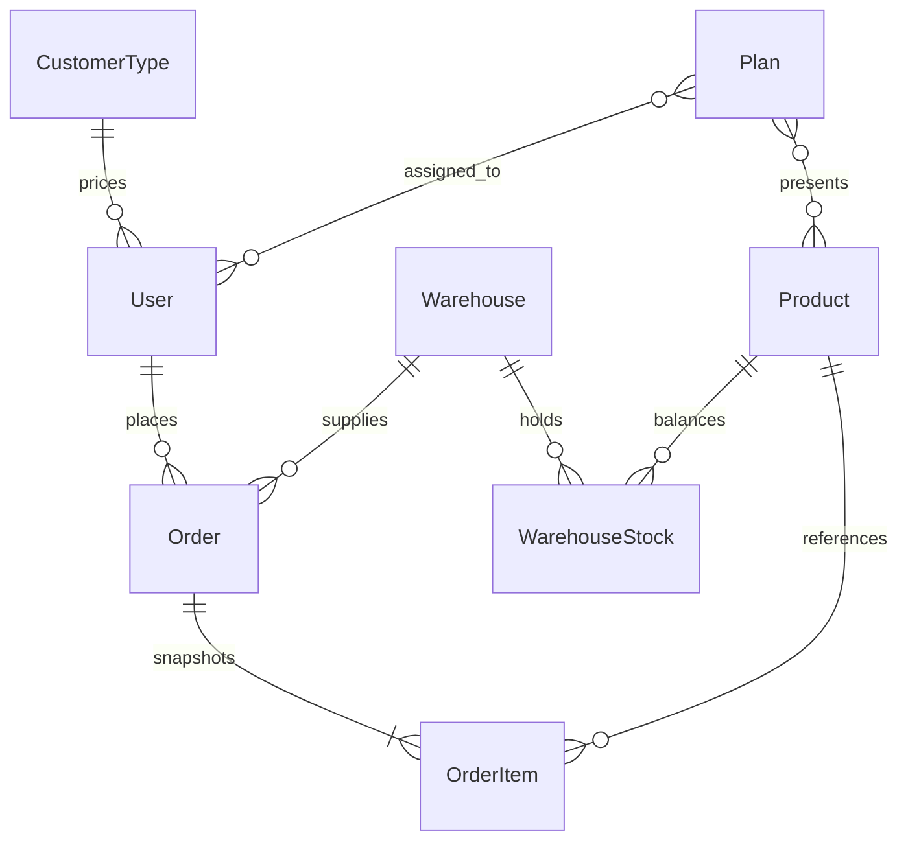

# 01 — Persisted domain models

Reviewed: 2026-11-07. CMS collection definitions and generated [Payload types](../apps/cms/src/payload-types.ts) describe persistence. Contract/UI DTOs can rename or omit fields; they are not additional database entities. PostgreSQL collection IDs are numeric; API boundaries also accept some string IDs.

## Customer and staff

`users`: required `fullName`, unique `phone`, `customerType`, `status` (`active`, `pending`, `suspended`). Optional company/address/identity details, address array, internal `notes`, `isBanned`, `banReason`, `allowedCategories`, `hideExactStock`, `disableOrdering`, `canUseProductQr`, and document array. Documents hold type, media file, review status (`pending`, `approved`, `rejected`), rejection reason and upload time. Empty allowed categories means unrestricted categories. Hiding exact stock also disables ordering. QR access defaults to false.

`admins`: Payload-authenticated email/password accounts with API-key support, `name`, optional `phone`, `isActive`, and selectable roles `superadmin`, `manager`, `service`. Admin/customer phone linking can create a separate customer record; staff identity is not the same collection as a customer.

`customer-types`: `name`, unique `slug`, required numeric `markupPercent`, optional description and active flag. Negative markup is supported. Historical orders store final monetary amounts, not a complete tier/markup snapshot.

## Products and taxonomies

`products`: required unique `sku`, unique `slug`, `name`; optional category/brand/tags/media, grade/color/rich description and dimensions. Slug derives from SKU when missing on creation and is preserved on ordinary updates. SKU immutability is not a declared collection invariant.

Optional unique `scanCode` is normalized to uppercase, accepts ASCII letters, digits and hyphens up to 128 characters, and preserves leading zeros. Empty values become null. It is independent of SKU and is editable; changing it invalidates previously printed QR codes.

- `productType`: `tile` or `other`.
- Tile `sqmPerCarton` is the positive selling factor used for orders; `piecesPerCarton`, dimensions and grade are metadata. Dimension/grade are not universally required by schema; do not describe a separate completeness blocker that is not implemented.
- Other primary `unit`: `bag`, `bucket`, `pack`, `can`, `branch`, `piece`, `box`, `roll`, `kg`, `liter`. Selling factor is 1 even if legacy carton metadata exists.
- `secondary_unit`, `weight`, `itemsPerPack`, `approxCoverage` describe contents; they do not convert ordered quantities to another selling unit.
- `basePricePerSqm` retains its historical field name: Tomans per square meter for tile, per primary selling unit for other.
- Product `inventorySqm`/`stockCartons` columns remain for schema compatibility, are hidden/write-blocked through normal field access, and are not the operational stock source.

`categories`, `brands`, `tags`, `dimensions`, `media` hold catalog metadata. See their [collection definitions](../apps/cms/src/collections) for individual constraints rather than treating illustrative trade attributes as implemented fields.

## Warehouses and sellable stock

`warehouses`: unique immutable `code`, `name`, `isActive`; deletion forbidden. `warehouse-stock`: unique `(warehouse, product)`, `inventorySqm` (nonnegative, at most two decimals), `revision`, timestamps; virtual `stockCartons` is derived. The historical `inventorySqm` name denotes the product's primary unit. Direct update/delete is forbidden; controlled reservation/restore/import changes it. Missing balance means zero.

Product type/primary unit cannot change after a balance exists. Packaging changes are checked under a product lock and rejected while open reservations exist.

## Orders

`orders`: unique `orderNumber`, customer relation `user`, required `warehouse`, warehouse name/code snapshot, `status`, optional `cancelledBy`, items, financial totals, address/notes, timeline and timestamps. API retry keys are customer-scoped hashes, backed by a unique `idempotencyKey`; `requestFingerprint` distinguishes different requests.

Each embedded item stores `product`, `productType`, `unit`, `salesFactor`, `requestedArea`, `cartonCount`, `deliverableArea`, `unitPrice`, `totalPrice`. Legacy names remain for non-tile quantities; `cartonCount` means whole primary units for other. The preparation hook also computes productName/productSku, but these are absent from collection item fields/generated persistence types; do not claim durable name/SKU snapshots. The customer display can resolve current product metadata. Older records can lack the newly added snapshot metadata; web mapping has fallbacks to populated products.

Persisted timeline entries contain timestamp/status (and Payload array IDs). They are not a separate full actor/event table. The three-step customer timeline is derived display behavior. `discountAmount` and `taxAmount` are currently set to zero at creation; `finalTotal = subtotal`.

## Plans and audit

`plans`: required title/content and assigned `users`; optional `products`, `startsAt`, `expiresAt`, and `isActive`. Tier-targeting, tenor, interest and prepayment fields from the former design document are not persisted plan fields.

`audit-logs`: action/entity, target/details, optional admin relation/name/IP, timestamps. Normal update/create is denied; server hooks write through Local API. Superadmin can read **and delete** logs, so this is not append-only storage against the highest-privilege role.

`otps` persists phone/code/expiry/cooldown/attempts/customer reference.
