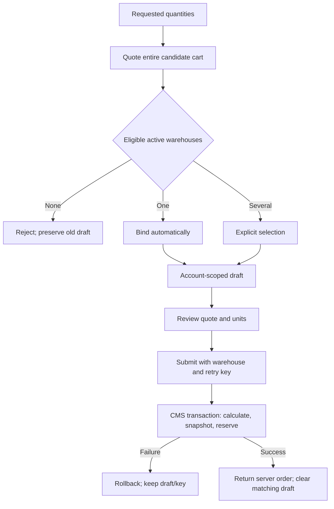
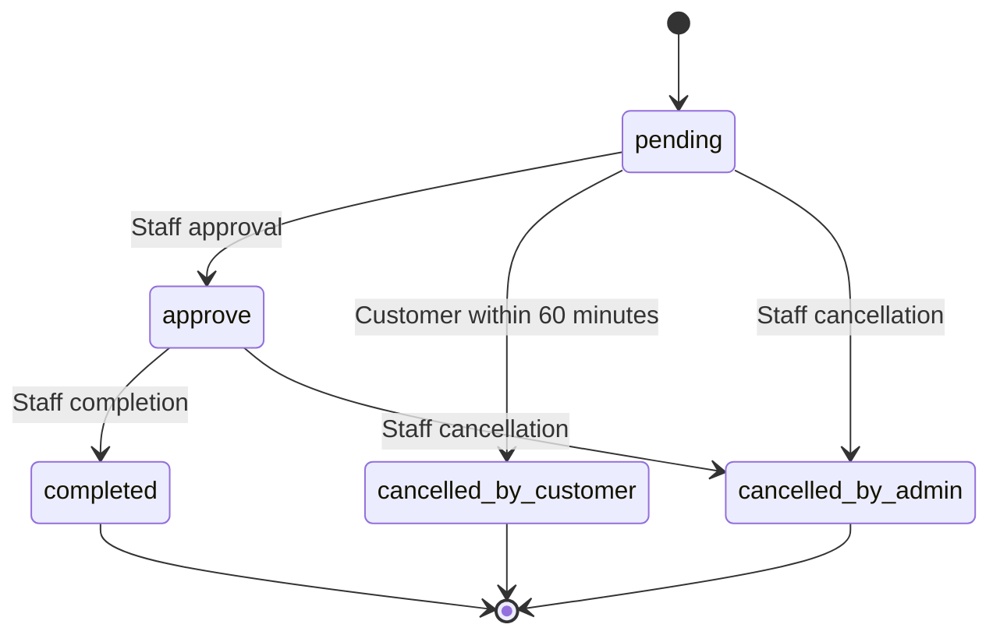

# 03 — System flows

Reviewed: 2026-11-07. Diagrams reflect current handlers, not planned endpoints.

## Customer authentication

`auth.requestOtp` (and its customer alias) normalizes Persian/Arabic digits and validates an Iranian mobile number. The account must exist, be active, not banned and not pending document approval. An active admin phone can be linked to a separate customer account by existing helpers.

OTP is four digits, expires after 120 seconds, has a 60-second request cooldown and at most five verification attempts. Records persist through CMS. SMS delivery failure invalidates the issued code. `auth.verifyOtp` issues a signed customer JWT; API context verifies the token and reloads account state. Web polls session every four seconds and on focus; logout clears query cache. JWT revocation storage is process-local, not a documented distributed revocation service.

Sources: [auth](../apps/api/src/routers/auth.ts), [OTP](../apps/api/src/lib/otp.ts), [JWT](../apps/api/src/lib/jwt.ts), [context](../apps/api/src/rpc/context.ts).

## Selection to order

Changes to a bound cart are checked against its warehouse. Account switches/removals invalidate stale async work; another tab invalidates stored quotes. Order responses and caches must not expose a previous account after logout. See [selection store](../apps/web/src/features/products/selection-store.ts) and [order store](../apps/web/src/features/orders/order-store.ts).

## Persisted order state

`cancel` is normalized using `cancelledBy`. The database update lock and status comparison prevent concurrent transitions restoring stock twice. The customer timeline is a projection: after 60 minutes it can show sales review while stored status remains `pending`.

## Reorder

Read an authorized historical order → require an empty current draft → quote current quantities and warehouses → choose a fresh warehouse → review current quote → submit a new order/key. Historical price and warehouse do not authorize a new reservation. Current screens block reorder actions for cancelled orders; no local reactivation path is supported.

## CSV

Stock: select warehouse → parse/validate CSV → read product versions and balance revisions → show signed preview → human apply → lock/check warehouse/products → conditional updates/create missing balances + audit → commit all or rollback all. A completed import has no automatic undo operation.

Price: official Payload import-export plugin → validate rows and SKU existence → whitelist SKU/base price → update existing products. This is not the signed warehouse stock pipeline and does not have its documented token/revision mechanism.

## Plans

CMS assigns a plan to users and optional products. API exposes active assigned plans with derived upcoming/active/expired status; expired/upcoming records can still be returned with that status. Web handles display and selection of plan products. Plan content is informational and is not a pricing engine. Adding recipients can trigger a notification SMS; tests/seed must explicitly disable those notifications.
