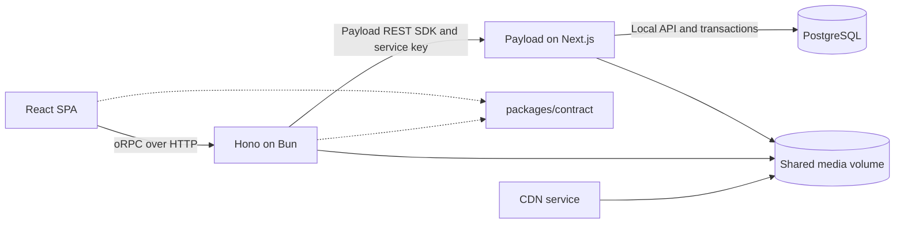

# 05 — Architecture, contracts and deployment configuration

Reviewed: 2026-11-07. Deployed infrastructure state is [UNKNOWN]; repository configuration is described below.

## Runtime boundaries

`pnpm` workspaces cover `apps/*` and `packages/*`; package manager is pinned in root `package.json`. `apps/web` uses React 19, TypeScript 7, Vite 8, TanStack Router/Query, HeroUI v3 and Tailwind v4. API/CMS TypeScript versions come from their own manifests and must not be described as uniformly TypeScript 7. Bun is the API runtime, not the package manager.

API business data goes through [CMS SDK](../apps/cms/src/sdk.ts); the running API does not use a local Payload database engine for normal commerce requests. The CMS package exposes a pure inventory helper subpath used for consistent selling factors. Local Payload exists for migrations, seed and administrative server code.

## Actual contract surface

The root [appContract](../packages/contract/src/index.ts) exports `health`, `echo`, `auth`, `catalog`, `shopping`, `customer`, `user`, `order`, `plan`, `warehouse`. There is no `system` router in the current root, despite a stale source comment referring to it.

Relevant names are `auth.session`, `catalog.getById`, `order.pricing.validateCart`, `order.submit`, `order.cancel`, `order.prepareReorder`, `warehouse.availability`, and `shopping.createOrder`. The latter delegates to the same submit implementation. Do not use former conceptual names such as `getBySlug`, `cancelByCustomer`, `system.previewCsvImport` or `getGlobalConfig` as executable API documentation.

Stock CSV endpoints are Payload collection endpoints: `/api/warehouse-stock/preview`, `/apply`, `/export`; their data schemas are in the shared contract. They are not oRPC `system` procedures. Payload Admin endpoints and Hono health/media routes also exist outside oRPC.

Contracts contain a mixture of specific schemas and legacy permissive outputs (`z.any`/unions); contract-first does not mean every response is strictly validated. Changed order submit/detail/cancel boundaries use `CustomerOrderDocumentSchema`; persistence shapes remain defined by CMS collections, with generated types.

## Transport and errors

Hono serves oRPC at `/api/rpc`. Context resolves bearer JWT and CMS account state; `requireAuth`/`requireAdmin` wrap selected procedures. Server-side `call` tests exercise procedures but do not by themselves prove socket, JWT or middleware integration.

Defined codes include `BAD_REQUEST`, `UNAUTHORIZED`, `FORBIDDEN`, `NOT_FOUND`, `CONFLICT`, `INSUFFICIENT_STOCK`, `CANCELLATION_DEADLINE_EXPIRED`, `INVALID_STATUS_TRANSITION`; permission lookup failures can raise `SERVICE_UNAVAILABLE`. Exact error/data/status shape depends on each contract and handler. Do not promise a universal SKU/stock/quantity error payload or HTTP 400 for every custom code.

## Media

CMS stores media under its `media` directory and can return CDN URLs. API uses `MEDIA_DIR` when set and otherwise its CMS media path, with file delivery fallbacks. Current CMS upload MIME list is JPEG/PNG/WebP/AVIF; do not promise SVG acceptance based on a prior diagram. Delivery code sets long-lived immutable caching for media file responses; filename replacement/invalidation behavior must be considered operationally.

## Compose topology

[docker-compose.yml](../docker-compose.yml) defines `migration`, `api`, `cms`, `web`, `cdn` on external `dokploy-network`. It does **not** define a PostgreSQL service. A reachable external database and its provisioning are deployment prerequisites; the hostname used by a connection setting does not create a service.

Migration is a one-shot command and API/CMS depend on its success. CMS PostgreSQL adapter also has `push: false` and `prodMigrations: migrations`. This configuration is not proof of zero-downtime deployment: warehouse-order migration deliberately rejects nonempty order history. See the [runbook](06-admin-and-operations.md).

Shared volume mounts differ by service: API `/app/media`, CMS `/app/apps/cms/media`, CDN `/data:ro`. Normal ports are API 5175, CMS 5174, web/CDN container 80; local Vite defaults to 5173.

## Configuration names

- Database: `DATABASE_URL` takes precedence over `DATABASE_URI` in CMS.
- Service calls: `CMS_API_URL`/`PAYLOAD_URL`/`CMS_URL` and `CMS_API_KEY`; SDK resolver specifies precedence.
- Authentication: `PAYLOAD_SECRET`, `JWT_SECRET` and Kavenegar environment configuration.
- Media: `MEDIA_DIR`, `CDN_URL` and frontend build-time settings.
- Tests/seed: use explicit disposable DB settings and `DISABLE_SMS=true` for CMS notification hooks. OTP sending uses a separate Kavenegar helper; this flag must not be treated as proof that a test invoking OTP can never send SMS.

Never copy credentials or fallback values from repository configuration into documentation examples.
