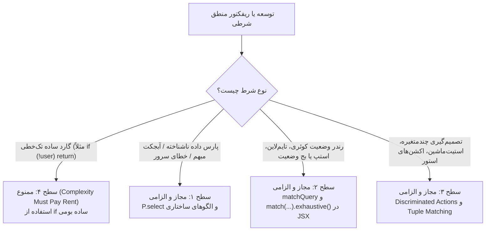

# 10 — استاندارد و راهنمای الگوی تطبیق (ts-pattern) در فرانت‌اند

> **Authority & Scope:** این سند استاندارد مرجع معماری برای استفاده از کتابخانه `ts-pattern` در لایه فرانت‌اند (`apps/web`) پروژه **PersianPart 2.0** است. کلیه تغییرات کد، ریفکتورها و توسعه ماژول‌های جدید باید بر اساس این قواعد انجام گیرند.

---

## ۱. فلسفه و هدف معماری (Rationale)

هدف اصلی به‌کارگیری `ts-pattern` در این پروژه:
1. **امنیت کامپایل صددرصدی (Type-Safety & Exhaustiveness):** جلوگیری از خطاهای زمان اجرا ناشی از اضافه شدن استاتوس‌های جدید در قراردادهای بک‌اند (`@persianpart/contract`) با تکیه بر متد `.exhaustive()`.
2. **حذف Type-Castهای خطرناک (`as ...`):** حذف کست‌های دستی در استورها و تبدیل آن‌ها به اکشن‌های تفکیک‌پذیر (Discriminated Actions) که توسط کامپایلر کنترل می‌شوند.
3. **افزایش خوانایی و حذف ترنری‌های تو در تو (Ternary Hell):** تبدیل شرط‌های پراکنده و ترنری‌های چندطبقه به ماتریس‌های تصمیم‌گیری شفاف (Decision Tables) و یکپارچه‌سازی رندرهای TanStack Query با هلپر مشترک `matchQuery`.

---

## ۲. سطوح مجاز و غیرمجاز پذیرش (Adoption Tiers)



### سطوح مجاز:
* **سطح ۱ (Data Layer & Parsing):** اعتبارسنجی مقادیر `unknown`، نرمال‌سازی فایل/مدیا، هندلینگ خطاهای API و تفکیک ساختار داده بدون `typeof`های تودرتو.
* **سطح ۲ (Presentation & Rendering):** رندر استیت‌های ۴ گانه داده (`pending | error | empty | success`) با هلپر مشترک `matchQuery`، رندر نشان‌های وضعیت (Status Badges)، و فرم‌های چندمرحله‌ای (Wizard/Steps).
* **سطح ۳ (Business State Machines & Actions):** تصمیم‌گیری‌های چندبعدی همبسته بر پایه Tuple Matching (مانند `match([status, isExpired, role])`)، و اکشن‌های استور بر پایه Discriminated Union Actions (`dispatchFilter({ key, value })`).

### سطح اکیداً ممنوع:
* **سطح ۴ (Dogmatic / Everything is a Pattern):** تبدیل شروط خطی ساده مثل `if (!isOpen) return null` یا `if (a > b) return a` به `match(...)` اکیداً ممنوع است. این کار خوانایی را تخریب کرده و نقض صریح اصل ۱.۵ سند `AGENTS.md` (**Complexity Must Pay Rent**) است.

---

## ۳. قواعد هفت‌گانه مصوب (The Approved Rules)

### قاعده ۱: تضمین جامعیت در برابر مرز سرور (Exhaustiveness vs Remote Boundary)
* **استیت‌های داخلی کلاینت (فرم‌ها، استپ‌ها، اکشن‌های استور):** الزام ۱۰۰٪ به `.exhaustive()`. عدم پوشش حتی یک استیت منجر به توقف بیلد خواهد شد.
* **داده‌های ورودی سرور (وضعیت سفارش، رکوردهای دیتابیس):** تطبیق کامل تمام حالت‌های شناخته‌شده قرارداد به همراه یک Fallback امن با ثبت هشدار (`console.warn` یا مانیتورینگ)؛ جهت جلوگیری از Crash کامل صفحه (White Screen) در شرایطی که بک‌اند فیلد جدیدی را مستقر کرده اما کلاینت هنوز کش یا بیلد قدیمی است.

```typescript
// ✅ درست برای داده‌های ورودی سرور
match(order.status)
  .with('completed', () => renderDone())
  .with(P.union('pending', 'checking', 'processing'), () => renderPending())
  .with(P.union('cancel', 'cancelled', 'cancelled_by_customer', 'cancelled_by_admin'), () => renderCancelled())
  .otherwise((unknownStatus) => {
    console.warn(`[Order] Unknown server status received: ${unknownStatus}`)
    return renderFallbackStatus(unknownStatus)
  })
```

### قاعده ۲: تبدیل متدهای استور به اکشن‌های تفکیک‌پذیر (Discriminated Store Actions)
برای حذف تمام کست‌های `as string`، `as string[]` و `as ViewMode` در استورها، اکشن‌ها باید به صورت Discriminated Union تعریف شوند:

```typescript
// ✅ تعریف استاندارد در استور
export type ProductFilterAction =
  | { type: 'searchQuery'; value: string | null }
  | { type: 'selectedBrands'; value: string[] }
  | { type: 'onlyInStock'; value: boolean }
  | { type: 'sortBy'; value: SortOption }

export function dispatchFilter(action: ProductFilterAction) {
  match(action)
    .with({ type: 'searchQuery' }, ({ value }) => setQueryFilters({ q: value }))
    .with({ type: 'selectedBrands' }, ({ value }) => setQueryFilters({ brands: value.length ? value : null }))
    .with({ type: 'onlyInStock' }, ({ value }) => setQueryFilters({ inStock: value ? true : null }))
    .with({ type: 'sortBy' }, ({ value }) => setQueryFilters({ sort: value === 'default' ? null : value }))
    .exhaustive()
}
```

### قاعده ۳: استاندارد رندر وضعیت کوئری با یوتیلیتی `matchQuery`
برای رندر یکپارچه وضعیت‌های کوئری و حذف کدهای تکراری در JSX، از یوتیلیتی مشترک `matchQuery` در `src/lib/match-query.ts` استفاده می‌شود:

```tsx
// ✅ درست: رندرینگ استاندارد، خوانا و تایپ‌سیف
{matchQuery(ordersQuery, {
  pending: () => <OrdersSkeleton />,
  error: () => <QueryLoadError message="دریافت سفارش‌ها ممکن نشد." onRetry={() => void ordersQuery.refetch()} />,
  empty: () => <OrdersEmptyState />,
  data: (orders) => orders.map(o => <OrderCard key={o.id} order={o} />),
})}
```

### قاعده ۴: استاندارد تطبیق چندمتغیره (Tuple Pattern Matching)
هر زمان منطق برنامه به **دو یا چند متغیر مستقل/همبسته** وابسته باشد، ساخت زنجیره‌های `if (a && b) else if (a && !c)` ممنوع است و باید از تاپل استفاده شود:

```typescript
// ✅ درست: ماتریس تصمیم‌گیری تک‌گام
const actionState = match([isAuthenticated, hasBlockingIssues, isSubmitting] as const)
  .with([false, P._, P._], () => 'NEEDS_LOGIN')
  .with([true, true, P._], () => 'BLOCKED')
  .with([true, false, true], () => 'SUBMITTING')
  .with([true, false, false], () => 'READY_TO_SUBMIT')
  .exhaustive()
```

### قاعده ۵: استخراج امن داده و حذف کامل `as ...` (Safe Data Extraction)
استفاده از Type Cast دستی روی ورودی‌های نامشخص یا رندرها ممنوع است. از `P.select()`، `P.string`، `P.number` و `P.instanceOf` استفاده کنید:

```typescript
// ✅ درست: استخراج تایپ‌سیف
const mediaUrl = match(input)
  .with(P.string.regex(/^(https?:\/\/|\/)/), (url) => url)
  .with({ url: P.select(P.string) }, (url) => url)
  .with({ filename: P.select(P.string) }, (fn) => `/api/media/file/${fn}`)
  .otherwise(() => '')
```

### قاعده ۶: تفکیک خطاهای ساخت‌یافته سرور (Server Error Matching)
پارس دستی خطاهای سرور با `typeof error === 'object'` ممنوع است. تمام خطاهای oRPC و فرم‌ها باید بر اساس الگوهای مشخص مچ شوند:

```typescript
// ✅ درست
match(error)
  .with({ code: 'UNAUTHORIZED' }, () => navigateToLogin())
  .with({ code: P.union('EXACT_STOCK_AVAILABLE', 'SOURCE_UNAVAILABLE') }, ({ code }) => handleStockConflict(code))
  .with({ message: P.select(P.string) }, (msg) => toast.error('خطا', msg))
  .otherwise(() => toast.error('خطا', 'خطای ناشناخته رخ داد.'))
```

### قاعده ۷: حفظ گاردکلازهای ساده (Simple Guard Clauses)
از پیچیده‌سازی بیهوده کدهای ساده بپرهیزید. شروط ساده زیر **نباید** بازنویسی شوند:
* `if (!user) return null;`
* `if (disabled || isPending) return;`
* ترنری‌های دوتایی بسیار ساده در پراپ‌های CSS: `className={isActive ? 'text-primary' : 'text-muted'}`

---

## ۴. ماتریس بررسی کیفی و کد ریویو (Code Review Checklist)

هر PR یا کدی که از `ts-pattern` استفاده می‌کند باید چک‌لیست زیر را پاس کند:
- [ ] آیا تمام استیت‌های کلاینت از `.exhaustive()` استفاده کرده‌اند؟
- [ ] آیا وضعیت‌های ریموت سرور دارای Fallback امن همراه با لاگ هشدار هستند؟
- [ ] آیا از به کار بردن `as any` یا `as Type` در کنار `match` پرهیز شده است؟
- [ ] آیا در صورت دستکاری استور، اکشن‌ها به شکل Discriminated Union تعریف شده‌اند؟
- [ ] آیا الگوها از گاردکلازهای ساده و تک‌شرطی محافظت کرده و آن‌ها را دست‌نخورده گذاشته‌اند؟
- [ ] آیا دستور `tsc --noEmit` در پکیج `@persianpart/web` با صفر خطا پاس می‌شود؟
