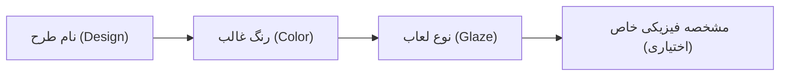
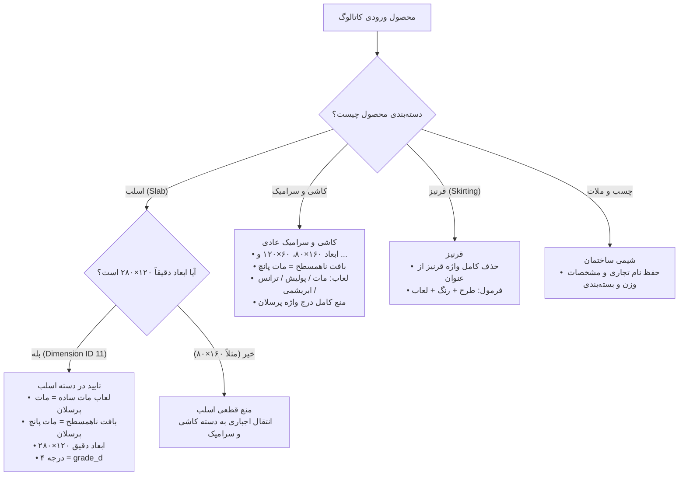

# 11 — استاندارد ساخت و نام‌گذاری محصولات (LLM-Only Standard)

> **Authority & Scope:** این سند استاندارد مرجع قطعی و لازم‌الاجرا برای تعریف، واردسازی (Import)، ویرایش و اعتبارسنجی مشخصات محصولات در پایگاه داده و کاتالوگ فروشگاه **PersianPart 2.0** است. کلیه مدیران کاتالوگ، اسکریپت‌های سیستمی و به‌ویژه **عامل‌های هوشمند (LLM Agents)** که از طریق ابزارهای MCP یا API به سامانه متصل می‌شوند، موظف به رعایت ۱۰۰٪ این استانداردها هستند.

---

## ۱. الگوی فرمول پایه نام‌گذاری (Canonical Naming Pattern)

عنوان تمامی محصولات کاشی، سرامیک، اسلب و قرنیز در فروشگاه باید بدون استثنا از فرمول سه‌بخشی زیر تبعیت کند:

$$\mathbf{Product\ Name} = \mathbf{Design\ (نام\ طرح)} + \mathbf{Color\ (رنگ)} + \mathbf{Glaze\ (نوع\ لعاب)}$$

### مثال‌های استاندارد:
- `ولورا کرم روشن مات پانچ`
- `مونزا بژ روشن پولیش`
- `ویژن سفید پولیش`
- `مالاگا صدفی مات`
- `پارلا صدفی روشن`
- `هما قهوه ای تیره مات`

---

## ۲. قواعد اکیداً ممنوعه (Inviolable Negative Invariants)

هرگونه نقض قواعد زیر موجب رد شدن رکورد کالا در ممیزی کاتالوگ خواهد شد:

### ۲.۱. ضوابط واژه «پرسلان» در نام کالا (استثنای انحصاری اسلب)
- واژه **«پرسلان»** مشخصه نوع بدنه و جنس کاشی است و در نام کالاهای عادی نباید درج یا تکرار شود.
- **استثنای انحصاری و الزامی دسته‌بندی اسلب (شناسه ۳):**
  - اسلب‌هایی که فقط لعاب مات دارند و بدون پانچ هستند، الزماً با عنوان **«مات پرسلان»** نام‌گذاری می‌شوند (مانند `مالاگا صدفی مات پرسلان`).
  - اسلب‌هایی که دارای بافت ناهمسطح و سه‌بعدی (پانچ) هستند، الزماً با عنوان **«مات پانچ پرسلان»** نام‌گذاری می‌شوند (مانند `ولورا کرم روشن مات پانچ پرسلان`).
- **کلیه سایر دسته‌بندی‌ها (کاشی و سرامیک، قرنیز و ...):** درج واژه «پرسلان» در نام کالا اکیداً ممنوع است و لعاب مات صرفاً به‌صورت **«مات»** یا **«مات پانچ»** درج می‌گردد:
  - ❌ **غلط در کاشی:** `والنسیا پرسلان صدفی` | ✅ **صحیح:** `والنسیا صدفی`
  - ❌ **غلط در کاشی:** `باربد پرسلان کرم` | ✅ **صحیح:** `باربد کرم`

### ۲.۲. ممنوعیت درج نام دسته‌بندی در عنوان محصول
- نام دسته‌بندی کالا (مانند **«اسلب»**، **«قرنیز»**، **«کاشی»** و **«سرامیک»**) نباید در عنوان کالا نوشته شود.
- هویت و تعلق کالای تجاری صرفاً از طریق رابطه `category` در دیتابیس تعیین می‌شود.
  - ❌ **غلط:** `قرنیز پارلا صدفی روشن` | ✅ **صحیح:** `پارلا صدفی روشن` (با دسته‌بندی قرنیز)
  - ❌ **غلط:** `اسلب ولورا مات پانچ` | ✅ **صحیح:** `ولورا کرم روشن مات پانچ` (با دسته‌بندی اسلب)
  - ❌ **غلط:** `اسپینا سرامیک کرم` | ✅ **صحیح:** `اسپینا 1260 کرم` (با دسته‌بندی کاشی و سرامیک)

### ۲.۳. حذف قطعی حرف لاتین W
- حرف **«W»** (که در نام‌گذاری سنتی مخفف غیررسمی Wall/دیواری بود) **به‌طور کامل و مطلق ممنوع** است و باید از تمامی عناوین حذف شود.
  - ❌ **غلط:** `هربین طوسی W مات` | ✅ **صحیح:** `هربین طوسی مات`
  - ❌ **غلط:** `وندا W طوسی روشن` | ✅ **صحیح:** `وندا طوسی روشن`
  - ❌ **غلط:** `وستا گل W آبی` | ✅ **صحیح:** `وستا گل آبی`

### ۲.۴. عدم درج درجه کیفی در عنوان کالا
- درجه کیفی کالا منحصراً در فیلد اختصاصی `grade` نگهداری می‌شود و نباید با کلماتی نظیر «یک»، «دو»، «درجهC» در نام کالا تکرار گردد.
  - ❌ **غلط:** `وستا مشکی یک` | ✅ **صحیح:** `وستا مشکی` (با فیلد `grade: "grade_1"`)

---

## ۳. قواعد تفکیک دسته‌بندی‌ها و ابعاد (Category Partitioning)

### ۳.۱. دسته‌بندی اسلب (Slab - شناسه ۳)
1. **شرط ابعادی تخطی‌ناپذیر:** فقط و فقط کالاهایی که ابعاد آن‌ها **۱۲۰×۲۸۰ سانتی‌متر** (شناسه بعد ۱۱ / `۲۸۰×۱۲۰`) است مجاز به ثبت در این دسته هستند. محصولاتی با ابعاد ۱۶۰×۸۰ یا سایر سایزها باید در دسته «کاشی و سرامیک» ثبت شوند.
2. **قاعده لعاب مات:** در اسلب‌ها، نوع لعاب مات کلاً **«مات پرسلان»** نامیده می‌شود (مانند `مالاگا صدفی مات پرسلان`).
3. **قاعده پانچ (Texture/3D Surface):** در صورت وجود بافت برجسته، ناهمسطح یا حس سه‌بعدی (پانچ)، عنوان لعاب کلاً **«مات پانچ پرسلان»** است (مانند `ولورا کرم روشن مات پانچ پرسلان`).
4. **استاندارد گرید اسلب:** در این دسته، هیچ محصولی با درجه کیفی `grade_4` مجاز نیست؛ تمامی اقلام درجه ۴ اسلب به **`grade_d`** استانداردسازی می‌شوند.

### ۳.۲. دسته‌بندی کاشی و سرامیک (Tile & Ceramic - شناسه ۱)
1. شامل کلیه سایزهای استاندارد و پرسلان‌های بزرگ‌مقیاس غیراسلب (۱۶۰×۸۰، ۱۲۰×۶۰، ۸۰×۸۰، ۶۰×۶۰ و ...).
2. بافت پانچ در این رده عنوان **«مات پانچ»** می‌گیرد.
3. انواع لعاب مجاز: `مات`، `پولیش`، `سمی پولیش`، `سوپر پولیش`، `ترانس`، `ابریشمی`، `چرمی`، `براق`.

### ۳.۳. دسته‌بندی قرنیز (Skirting - شناسه ۴)
1. عنوان کالا شامل نام طرح، رنگ و لعاب است (مثلاً `پارلا صدفی روشن`، `تامارا قهوه ای تیره`، `سلنیت صدفی پولیش`).
2. واژه «قرنیز» در عنوان حذف می‌شود.

### ۳.۴. دسته‌بندی چسب و ملات (Adhesive & Mortar - شناسه ۲)
1. عنوان شرکتی استاندارد به همراه کد کارخانه، وزن و نوع فرمول حفظ می‌شود (مانند `چسب پودری سفید استاندارد 20 کیلویی`).

---

## ۴. الزام همگام‌سازی فیلد رنگ (`products.color Invariant`)

1. **الزام تطابق ۱۰۰٪:** هر کالایی که در عنوان آن رنگ وجود دارد، فیلد `color` در موجودیت کالا در پایگاه داده باید **دقیقاً و عینا با همان رنگ** مقداردهی شود.
2. **عدم جواز مقدار null:** رها کردن فیلد `color` به‌صورت خالی (`null` یا رشته خالی) برای کالاهای دارای رنگ اکیداً ممنوع است.
3. **رنگ‌های چندکلمه‌ای:** ترکیب‌های ترکیبی (مانند `کرم روشن`، `طوسی تیره`، `قهوه ای تیره`، `بژ روشن`) باید به‌طور کامل در فیلد `color` ثبت شوند، نه صرفاً کلمه اول.

---

## ۵. واژگان رسمی رنگ‌ها و لعاب‌ها (Controlled Vocabularies)

### ۵.۱. واژگان مجاز رنگ‌ها (Colors)
| رنگ‌های اصلی | رنگ‌های روشن | رنگ‌های تیره | رنگ‌های خاص |
| :--- | :--- | :--- | :--- |
| سفید | کرم روشن | کرم تیره | صدفی / صدفی روشن |
| مشکی | طوسی روشن | طوسی تیره / خیلی تیره | بژ / بژ روشن |
| طوسی | آبی روشن | آبی تیره | ذغالی |
| کرم | نسکافه‌ای روشن | قهوه‌ای تیره | شکلاتی |
| قهوه‌ای | شیری روشن | سرمه‌ای / سرمه‌ای تیره | فیروزه‌ای / سبز تیره |
| آبی | سبز روشن | نوک مدادی / زرشکی | طلایی / گلد / گریژ |

### ۵.۲. واژگان مجاز لعاب‌ها (Glazes)
- **مات پانچ** (کاشی‌ها و اسلب‌های بافت‌دار و برجسته)
- **مات** (کاشی‌ها و اسلب‌های ساده مات؛ بدون ذکر واژه پرسلان)
- **پولیش** / **سوپر پولیش** / **سمی پولیش** / **نانو پولیش**
- **ترانس** (لعاب شیشه‌ای و شفاف)
- **ابریشمی** / **چرمی** / **براق**

---

## ۶. چک‌لیست اعتبارسنجی عامل‌های هوشمند (LLM Agent Verification Runbook)

قبل از فراخوانی متدهای `createProducts` یا `updateProducts` از طریق MCP یا API، عامل هوشمند موظف است گیت‌های زیر را اعتبارسنجی کند:

- [ ] **گیت ۱ (بررسی عنوان):** آیا عنوان کالا دقیقاً فرمت `[طرح] [رنگ] [لعاب]` را دارد؟
- [ ] **گیت ۲ (پاکسازی واژه پرسلان):** آیا واژه «پرسلان» در عنوان وجود دارد؟ (در صورت وجود، فوراً حذف شود؛ نوشتن «مات» یا «مات پانچ» کافی است).
- [ ] **گیت ۳ (پاکسازی W):** آیا حرف `W` در کل عنوان وجود دارد؟ (در صورت وجود، فوراً حذف شود).
- [ ] **گیت ۴ (پاکسازی دسته‌بندی):** آیا واژه‌های «اسلب»، «قرنیز»، «کاشی»، «سرامیک» در عنوان حضور دارند؟ (در صورت وجود، فوراً حذف شوند).
- [ ] **گیت ۵ (بررسی اسلب):** اگر دسته‌بندی اسلب (شناسه ۳) است، آیا بعد کالا دقیقاً ۱۲۰×۲۸۰ است؟ آیا لعاب مات صرفاً به «مات» یا «مات پانچ» تنظیم شده است؟
- [ ] **گیت ۶ (فیلد رنگ):** آیا فیلد `color` در Payload دقیقا برابر با رنگ استخراج‌شده از نام تنظیم شده است؟
- [ ] **گیت ۷ (درجه کالا):** آیا از ذکر کلمات درجه در نام اجتناب شده و فیلد `grade` متناسب با آن (`grade_1`, `grade_d`, ...) مقدار گرفته است؟

---

## ۷. ضوابط رابطه «طرح» و خانواده محصول (Product Families)

مفهوم «طرح» (خانواده محصول) ساختاری برای اتصال و مشاهدهٔ نسخه‌های مختلف یک محصول پایه (مانند رنگ‌ها، ابعاد، درجات و لعاب‌های گوناگون یک طرح) در کاتالوگ است. ضوابط حاکم بر این رابطه به شرح زیر است:

1. **اختیاری، دستی و تک‌مقداری:** رابطه با طرح کاملاً اختیاری (optional) و دستی (manual) است. هر کالا حداکثر می‌تواند عضو یک طرح باشد (`products.family`).
2. **استقلال در جابه‌جایی:** جابه‌جایی یا تغییر فیلد طرح روی یک کالا فقط و فقط همان محصول را منتقل می‌کند و هیچ‌گونه تأثیر جانبی یا جابه‌جایی ناخواسته‌ای روی سایر اعضای طرح قبلی یا جدید ندارد.
3. **ثبات مطلق فرمول نام‌گذاری، درجه و ابعاد:** فرمول سه‌بخشی بنیادین نام‌گذاری کالا ($\mathbf{Design} + \mathbf{Color} + \mathbf{Glaze}$) و همچنین ضوابط تفکیک درجه کیفی (`grade`) و ابعاد (`dimension`) کاملاً دست‌نخورده و بدون تغییر باقی می‌مانند. هر ترکیب از درجه، بعد، رنگ و لعاب، کماکان یک کالای کاملاً مستقل با شناسه، SKU، قیمت، موجودی و رفتار سفارش‌گذاری اختصاصی خود است.
4. **گروه‌بندی اولیه با ویرایش گروهی ادمین:** گروه‌بندی اولیه و متصل‌کردن دسته‌ای کالاهای موجود به طرح‌ها در پنل مدیریت از طریق قابلیت بومی ویرایش گروهی (Edit many) در فهرست محصولات (با فیلتر بر اساس نام/برند، انتخاب ردیف‌های کالا و تنظیم فیلد «طرح») انجام می‌گیرد.

### ۷.۱. مبنای گروه‌بندی: چه کالاهایی هم‌طرح‌اند؟

دو کالا فقط وقتی عضو یک طرح‌اند که **هر سه شرط** برقرار باشد:

1. **هم‌نام‌بودن طرح:** بخش «نام طرح» عنوان دو کالا (اولین بخش فرمول §۱، پیش از رنگ) یکی باشد، مثلاً `آلاوس طوسی روشن مات` و `آلاوس طوسی تیره پولیش`.
2. **هم‌برند بودن:** برند/تولیدکنندهٔ دو کالا یکی باشد. نام طرح یکسان در دو برند مختلف، دو طرح جداست.
3. **فقط تفاوت در ویژگی‌های نسخه:** کالاها فقط در رنگ، لعاب، بعد یا درجه تفاوت داشته باشند. تفاوت در نام طرح یا برند یعنی طرح دیگر.

قواعد تکمیلی:

- **شباهت ظاهری کافی نیست.** گروه‌بندی بر اساس نام و برند است، نه حدس دربارهٔ شباهت نقش یا رنگ. اگر شک دارید، گروه نکنید.
- **دسته‌بندی مانع نیست.** اگر طرح و برند یکی باشد، اسلب (۱۲۰×۲۸۰) و کاشی هم‌طرح می‌توانند در یک طرح باشند.
- **حداقل دو عضو.** برای کالای تنها طرح ساخته نمی‌شود؛ رابطه با اضافه‌شدن نسخهٔ دوم ساخته می‌شود. بخش «گزینه‌های دیگر» هم زیر دو عضو نمایش داده نمی‌شود.
- **نام طرح:** `[نام طرح] — [برند]`، مثلاً `آلاوس — پرسپولیس یزد`. پیش از ساخت، طرح هم‌نام موجود را جست‌وجو کنید و از ساخت تکراری بپرهیزید.
- **نام و املای طرح** باید با عنوان کالا یکی باشد (یک املا، بدون فاصلهٔ اضافه و بدون «پرسلان»، «اسلب» و واژه‌های ممنوع §۲).
- **فقط فیلد `family` تغییر می‌کند.** گروه‌بندی هیچ فیلد دیگری (نام، رنگ، درجه، بعد، قیمت، موجودی) را اصلاح نمی‌کند. کالایی که نامش از استاندارد این سند تخطی دارد، جدا گزارش می‌شود و در همین مرحله اصلاح نمی‌شود.
- **عضو غلط جابه‌جا می‌شود، طرح حذف نمی‌شود.** طرحی که به کالا وصل است حذف نمی‌شود (محافظ `protect-relations`).

### ۷.۲. روند گروه‌بندی توسط عامل هوشمند (MCP)

1. فهرست کالاهای محدودهٔ مورد نظر را بخوانید (برای مثال دستهٔ اسلب) و آن‌ها را بر اساس `(برند، نام طرح)` دسته کنید.
2. فهرست طرح‌های موجود (`product-families`) را بخوانید تا طرح تکراری ساخته نشود.
3. **پیشنهاد را بدون ثبت** به مدیر نشان دهید: هر طرح با نام و اعضایش (SKU، رنگ، لعاب، بعد، درجه)، گروه‌های تک‌عضوی، و موارد مشکوک یا مغایر با §۷.۱.
4. فقط پس از تأیید صریح مدیر، طرح‌ها را بسازید و `family` کالاها را تنظیم کنید. هر نوشتن با شناسهٔ مشخص انجام می‌شود و لاگ می‌شود.
5. پس از ثبت، شمار اعضای هر طرح را با خواندن دوباره بررسی و گزارش کنید.
