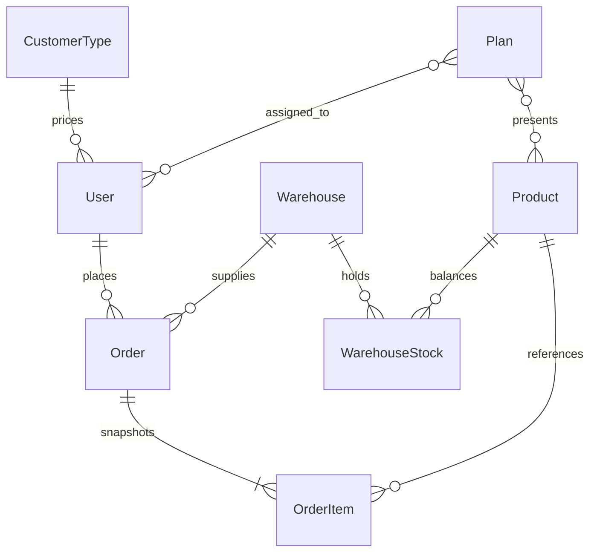

# 01 — Persisted domain models

Reviewed: 2026-11-22. CMS collection definitions and generated [Payload types](../../apps/cms/src/payload-types.ts) describe persistence. Contract/UI DTOs can rename or omit fields; they are not additional database entities. PostgreSQL collection IDs are numeric; API boundaries also accept some string IDs.

## Glossary (Persian term → meaning → where it lives)

| Persian | Meaning | Model / field |
| --- | --- | --- |
| نماینده فروش | Customer: a shop owner/retailer who buys from PersianPart | `users` |
| نوع مشتری | Price tier; `markupPercent` adjusts the shared base price | `customer-types` |
| طرح (محصول) | Product family grouping variants of one design; beta has 30, all under brand «پرسپولیس یزد» | `product-families` |
| طرح (فروش) | Sales-offer announcement; not a family. Informational only | `plans` |
| درجه / grade | Manufacturer-defined quality class; no logic attached | `products.grade` (`grade_1..4`, `grade_d`, `grade_c`, `cg3`) |
| انبار مشهد / کارخانه | `exact` warehouse / `inquiry` warehouse | `warehouses.stockMode` |
| درخواست تأمین | Manual availability request for non-exact stock | `supply-requests` |
| کیمیا | Kimia accounting software whose daily export feeds price/stock import | CSV importer in `warehouse-stock` |

"طرح" is ambiguous: always say *product family* or *sales plan* in code and docs.

## Observed beta facts (2026-11-22, not production)

- `dimensions.name` is display text (e.g. «۶۰×۲۰») while `width`/`height` store the numeric size with width ≤ height (`width 20, height 60`). The slug follows `width x height` (`20x60`). Do not derive size from the name.
- Slab products (category 3, 120×280, `sqmPerCarton 3.36`, `cartonsPerPallet 36`) were observed with `unit: "bag"` while `productType: "tile"`. For tile, the selling factor is `sqmPerCarton`; treat the `unit` value there as inconsistent legacy metadata `[ASSUMPTION]` and verify before relying on it.
- Orders observed with null `productName`/`productSku` on lines (order 1, created before snapshotting). Orders 2–4 carry them.
- Two brands exist; the three newest products sampled use brand 1; brand 2 usage is unverified.

## Customer and staff

`users`: required `fullName`, unique `phone`, `customerType`, `status` (`active`, `pending`, `suspended`). Optional company/address/identity details, address array, internal `notes`, `isBanned`, `banReason`, `allowedCategories`, `hideExactStock`, `disableOrdering`, `canUseProductQr`, and document array. Documents hold type, media file, review status (`pending`, `approved`, `rejected`), rejection reason and upload time. Empty allowed categories means unrestricted categories. Hiding exact stock also disables ordering. QR access defaults to false.

`admins`: Payload-authenticated email/password accounts with API-key support, `name`, optional `phone`, `isActive`, and selectable roles `superadmin`, `manager`, `support`, `service`. Admin/customer phone linking can create a separate customer record; staff identity is not the same collection as a customer.

`customer-types`: `name`, unique `slug`, required numeric `markupPercent`, optional description and active flag. Negative markup is supported. Historical orders store final monetary amounts, not a complete tier/markup snapshot.

## Products and taxonomies

`products`: required unique `sku`, unique `slug`, `name`; optional category/brand/tags/media, grade/color/rich description and dimensions. Slug derives from SKU when missing on creation and is preserved on ordinary updates. SKU immutability is not a declared collection invariant.

`qr-codes`: opaque 8-character uppercase `token` (generated in CMS), optional `product` relationship (many-to-one), optional `store`, optional `note`, and `isActive`. Only managers and superadmins can create or edit `qr-codes`, and deletion is forbidden. Printed labels are 60 × 80 mm PNGs rendered by the CMS pointing to `/Q/<token>`.

- `productType`: `tile` or `other`.
- Tile `sqmPerCarton` is the positive selling factor used for orders; `piecesPerCarton`, dimensions and grade are metadata. Dimension/grade are not universally required by schema; do not describe a separate completeness blocker that is not implemented.
- Other primary `unit`: `bag`, `bucket`, `pack`, `can`, `branch`, `piece`, `box`, `roll`, `kg`, `liter`. Selling factor is 1 even if legacy carton metadata exists.
- `secondary_unit`, `weight`, `itemsPerPack`, `approxCoverage` describe contents; they do not convert ordered quantities to another selling unit.
- `basePricePerSqm` retains its historical field name: Tomans per square meter for tile, per primary selling unit for other.
- Product `inventorySqm`/`stockCartons` columns remain for schema compatibility, are hidden/write-blocked through normal field access, and are not the operational stock source.

`categories`, `brands`, `tags`, `dimensions`, `media` hold catalog metadata. See their [collection definitions](../../apps/cms/src/collections) for individual constraints rather than treating illustrative trade attributes as implemented fields.

## Warehouses and sellable stock

Warehouses have an `exact` or `inquiry` stock mode. Existing warehouses migrate to `exact`; an inquiry warehouse has active product relationships in `supply-sources`, rather than a numeric balance. A supply request snapshots one customer, product, inquiry warehouse, quantity, packaging and estimated price. Tile products may have an optional cartons-per-pallet factor; new order items snapshot it for historical display.

`warehouses`: unique immutable `code`, `name`, `isActive`; deletion forbidden. `warehouse-stock`: unique `(warehouse, product)`, `inventorySqm` (nonnegative, at most two decimals), `revision`, timestamps; virtual `stockCartons` is derived. The historical `inventorySqm` name denotes the product's primary unit. Direct update/delete is forbidden; controlled reservation/restore/import changes it. Missing balance means zero.

Product type/primary unit cannot change after a balance exists. Packaging changes are checked under a product lock and rejected while open reservations exist.

## Orders

`orders`: unique `orderNumber`, customer relation `user`, required `warehouse`, warehouse name/code snapshot, `status`, optional `cancelledBy`, items, financial totals, address/notes, timeline and timestamps. API retry keys are customer-scoped hashes, backed by a unique `idempotencyKey`; `requestFingerprint` distinguishes different requests.

Each embedded item stores `product`, `productType`, `unit`, `salesFactor`, `requestedArea`, `cartonCount`, `deliverableArea`, `unitPrice`, `totalPrice`. Legacy names remain for non-tile quantities; `cartonCount` means whole primary units for other. The preparation hook also computes productName/productSku, but these are absent from collection item fields/generated persistence types; do not claim durable name/SKU snapshots. The customer display can resolve current product metadata. Older records can lack the newly added snapshot metadata; web mapping has fallbacks to populated products.

Persisted timeline entries contain timestamp/status (and Payload array IDs). They are not a separate full actor/event table. The three-step customer timeline is derived display behavior. `discountAmount` and `taxAmount` are currently set to zero at creation; `finalTotal = subtotal`.

## Plans and audit

`plans`: required title/content and assigned `users`; optional `products`, `startsAt`, `expiresAt`, and `isActive`. Tier-targeting, tenor, interest and prepayment fields from the former design document are not persisted plan fields.

`audit-logs`: action/entity, target/details, optional admin relation/name/IP, timestamps. Normal update/create is denied; server hooks write through Local API. Superadmin can read **and delete** logs, so this is not append-only storage against the highest-privilege role.

`otps` persists phone/code/expiry/cooldown/attempts/customer reference.
