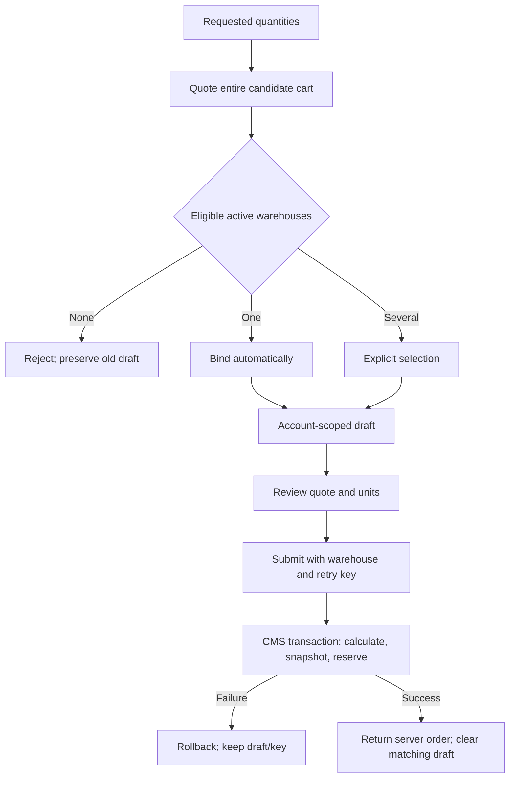
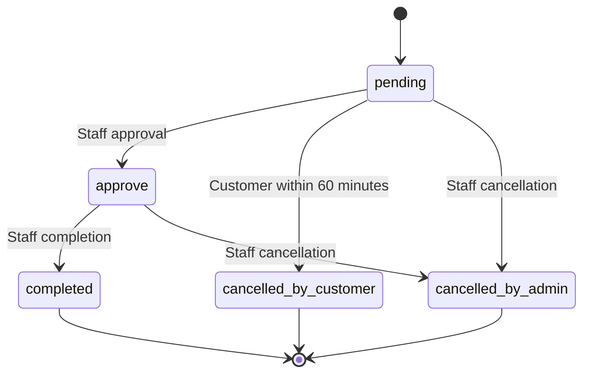
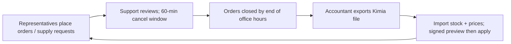

# 03 — System flows

Reviewed: 2026-11-22. Diagrams reflect current handlers, not planned endpoints.

## Customer authentication

`auth.requestOtp` (and its customer alias) normalizes Persian/Arabic digits and validates an Iranian mobile number. The account must exist, be active, not banned and not pending document approval. An active admin phone can be linked to a separate customer account by existing helpers.

OTP is four digits, expires after 120 seconds, has a 60-second request cooldown and at most five verification attempts. Records persist through CMS. SMS delivery failure invalidates the issued code. `auth.verifyOtp` issues a signed customer JWT; API context verifies the token and reloads account state. Web polls session every four seconds and on focus; logout clears query cache. JWT revocation storage is process-local, not a documented distributed revocation service.

Sources: [auth](../../apps/api/src/routers/auth.ts), [OTP](../../apps/api/src/lib/otp.ts), [JWT](../../apps/api/src/lib/jwt.ts), [context](../../apps/api/src/rpc/context.ts).

## Selection to order

The catalog also offers an independent supply-request mode. Preview returns the current estimate and inquiry warehouses; submission revalidates the source, customer, price and exact-stock eligibility in the CMS. A customer-scoped key permits safe replay of the same submission. Results appear under the supply-request tab in orders; coordination after the result is outside the application.

Changes to a bound cart are checked against its warehouse. Account switches/removals invalidate stale async work; another tab invalidates stored quotes. Order responses and caches must not expose a previous account after logout. See [selection store](../../apps/web/src/modules/catalog/selection-store.ts) and [order store](../../apps/web/src/modules/orders/order-store.ts).

## Persisted order state

`cancel` is normalized using `cancelledBy`. The database update lock and status comparison prevent concurrent transitions restoring stock twice. The customer timeline is a projection: after 60 minutes it can show sales review while stored status remains `pending`.

## Reorder

Read an authorized historical order → require an empty current draft → quote current quantities and warehouses → choose a fresh warehouse → review current quote → submit a new order/key. Historical price and warehouse do not authorize a new reservation. Current screens block reorder actions for cancelled orders; no local reactivation path is supported.

## CSV

Stock and price imports share a signed preview and transactional apply. Stock targets one active warehouse; prices are global. Kimia CSV supplies both and converts Rials to Tomans. Invalid or duplicate rows and unknown SKUs are shown and excluded; valid rows are applied together after product and inventory revision checks, or all rolled back. A completed import has no automatic undo.

## Plans

CMS assigns a plan to users and optional products. API exposes active assigned plans with derived upcoming/active/expired status; expired/upcoming records can still be returned with that status. Web handles display and selection of plan products. Plan content is informational and is not a pricing engine. Adding recipients can trigger a notification SMS; tests/seed must explicitly disable those notifications.

## Customer lifecycle (business view)

1. **Onboarding.** Staff create the account; the customer uploads documents; an admin manually verifies each one and approves or rejects it with a reason. Login is blocked while the account is inactive, banned or pending document approval (see §Customer authentication).
2. **Active use.** The representative browses stock/prices, reserves via orders, and files supply requests.
3. **Hold.** The company puts a person on hold («معلق»), temporarily or permanently, when it ends or pauses the relationship, and stops answering them. The decision is manual and based on financial dealings and company policy. Which stored status represents hold (`pending` or `suspended`) is `[UNKNOWN]`.

## Daily operations cycle

- Settlement, shipping and delivery occur in the company's own systems; the last state recorded here is `completed` ([business-rules R8](business-rules.md)).
- `inquiry` warehouse stock is unknown to this system; staff ask the factory contact and report back outside the system ([R4](business-rules.md), [R5](business-rules.md)).
- The Kimia CSV is an input *template*. A future accounting API or another template would be an additional importer, not a change to the order flow.
- Staff should be able to see in the admin panel that an order is still within the 60-minute customer-cancel window. This is **not implemented** in the CMS today ([R7](business-rules.md)).
